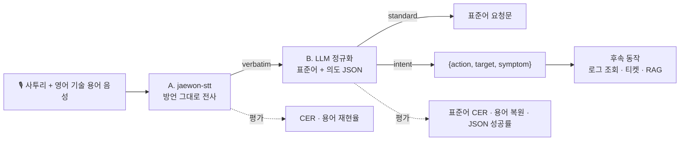
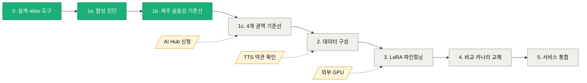
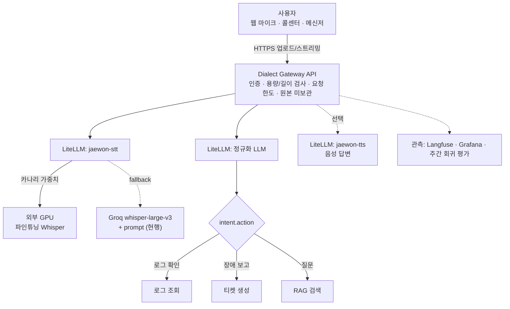

# korean-dialect-stt

> 경상·전라·충청·강원·제주 사투리와 한국어·영어 기술 용어가 섞인 발화를 **들린 그대로 받아쓰고(STT)**, **표준어 요청과 의도(JSON)로 해석**하는 음성 이해 파이프라인.

```text
"야, Kubernetes Pod가 와 이래 자꾸 죽노? 로그 좀 봐도."   (경상도 사투리 + 영어 기술 용어)
        │  A. jaewon-stt  (방언 전사)
        ▼
"야, Kubernetes Pod가 와 이래 자꾸 죽노? 로그 좀 봐도."   (들린 그대로)
        │  B. LLM 정규화 (표준어 변환 + 의도 추출)
        ▼
"Kubernetes Pod가 왜 계속 종료되는지 로그를 확인해 주세요."
{"action": "로그 확인", "target": "Kubernetes Pod", "symptom": "잦은 종료"}
```

| 항목 | 내용 |
| --- | --- |
| 상태 | **1단계 완료** (합성 진단 + 실제 제주어 음성 기준선) — 2026-10-29 기준. 다음: AI Hub 데이터·GPU 확보 후 파인튜닝 |
| 공개 범위 | 비공개(private) |
| 모델 이름 | `jaewon-stt` (음성→텍스트), `jaewon-tts` (텍스트→음성) |
| 게이트웨이 | LiteLLM (OpenAI 호환 `/v1/audio/transcriptions`, `/v1/audio/speech`) |

## 한눈에 보기

| 핵심 수치 | 값 | 의미 |
| --- | --- | --- |
| prompt 적용 효과 (합성, CER) | **47.8% → 25.3%** | 기술 용어 문장에서 오류 절반 |
| 기술 용어 재현율 (STT → LLM) | **1.7% → 34.2% → 68.3%** | prompt와 LLM 복원이 단계적으로 개선 |
| 실제 제주어 기준선 CER | **28.5%** (prompt 없음 30.1%) | 일상 방언에는 prompt 효과가 작음 → 파인튜닝 필요 |
| STT 오류 비용 (표준어 CER) | **+11.5%p** (합성) / **+8.4%p** (제주) | 전사를 고치면 LLM 단계도 그만큼 좋아짐 |
| 의도 JSON 성공률 | **100%** | 후속 자동화 연결 가능 |

<picture>
  <source media="(prefers-color-scheme: dark)" srcset="docs/charts/dataset-cer-dark.svg">
  
</picture>

---

## 목차

1. [목표](#1-목표)
2. [설계 원칙: 왜 두 단계로 나누는가](#2-설계-원칙-왜-두-단계로-나누는가)
3. [현재까지 진행한 내용](#3-현재까지-진행한-내용)
4. [평가 지표와 1차 결과](#4-평가-지표와-1차-결과)
5. [데이터와 라이선스](#5-데이터와-라이선스)
6. [저장소 구조](#6-저장소-구조)
7. [사용 방법](#7-사용-방법)
8. [로드맵](#8-로드맵)
9. [예상 결과](#9-예상-결과)
10. [서비스 방법](#10-서비스-방법)
11. [한계와 주의 사항](#11-한계와-주의-사항)

---

## 1. 목표

### 최종 목표

경상·전라·충청·강원·제주 **5개 권역 사투리**와 **한국어·영어 혼용(code-switching)** 을 모두 인식하는 범용 한국어 STT와, 그 결과를 표준어 요청·의도로 바꾸는 해석 계층을 하나의 서비스로 제공한다.

### 해결하려는 문제

- 표준어 중심으로 학습된 STT는 사투리 어미·어휘(`죽노`, `했당께`, `했슈`, `했드래요`, `죽엄수과`)에서 인식률이 크게 떨어진다.
- 한국어 문장 안의 영어 기술 용어(`Kubernetes`, `CrashLoopBackOff`, `Argo CD`)는 한글 발음 표기(`키버넷`, `잉그레스`)로 잘못 받아써져 검색·자동화에 쓸 수 없다.
- 현장 운영 담당자·고객 상담처럼 **말로 장애를 보고하는 상황**에서 위 두 문제가 동시에 일어난다.

### 세부 목표

| 구분 | 목표 |
| --- | --- |
| A. 방언 전사 | 권역별 CER(문자 오류율) 개선, 사투리 어미를 표준어로 "고치지 않고" 그대로 받아쓰기 |
| A. 기술 용어 | 영어 기술 용어를 라틴 문자로 정확히 표기(용어 재현율) |
| B. 표준어 변환 | 의미 보존, 문장 종류·높임 유지, 잘못 전사된 용어 복원 |
| B. 의도 추출 | `{action, target, symptom}` JSON을 안정적으로 출력해 후속 자동화(로그 조회 등)에 연결 |
| 운영 | 모델 교체가 호출자에 영향을 주지 않는 고정 이름(alias), 재현 가능한 평가, 비용·약관 통제 |

---

## 2. 설계 원칙: 왜 두 단계로 나누는가

| 단계 | 입력 → 출력 | 담당 | 평가 |
| --- | --- | --- | --- |
| **A. 방언 전사** | 음성 → 들린 그대로의 방언 문장 | `jaewon-stt` (Whisper, 이후 파인튜닝 모델) | CER, 용어 재현율 |
| **B. 표준어 변환·의도 해석** | A 결과 → 표준어 + 의도 JSON | LLM | 표준어 CER, 용어 복원율, JSON 성공률 |



| 비교 | 단일 단계 (음성 → 표준어 직접) | **두 단계 (이 프로젝트)** |
| --- | --- | --- |
| 정량 평가 | 정답과 발화가 달라 CER 측정 불가 | 단계별로 CER 측정 가능 |
| 오류 원인 추적 | 인식 오류와 해석 오류가 섞임 | oracle 비교로 분리 |
| 환각 위험 | 들리지 않은 표준어 생성 가능 | 전사는 들린 그대로, 해석은 LLM이 문맥으로 |
| 원문 확인 | 원문 소실 | `verbatim`과 `standard` 동시 제공 |
| 모델 교체 | 전체 재학습 | STT·LLM 각각 교체 |

Whisper가 처음부터 표준어를 출력하도록 학습하지 않는 이유:

1. **평가 불가능** — 발화와 정답 텍스트가 달라져 CER로 측정할 수 없다.
2. **환각 증가** — 들리지 않은 단어를 만들어 내는 경향이 커진다.
3. **오류 원인 분리 불가** — `죽노`를 "종료"로 볼지 "재시작 반복(CrashLoopBackOff)"으로 볼지는 맥락 해석 문제인데, 이것이 음성 인식 오류와 섞인다.

이 저장소의 평가 도구는 두 단계를 **각각** 측정한다. 특히 `--oracle` 모드는 정답 전사를 B단계에 직접 넣어 **LLM 단독 성능**을 재고, 실제 STT 결과를 넣은 값과 비교해 **STT 오류가 최종 품질을 얼마나 깎는지** 분리해 보여 준다.

### 표기 규칙

- 영어 기술 용어는 **라틴 문자**(`Kubernetes Pod`)로 통일한다. 정답 표기가 섞이면 모델 출력도 섞인다.
- CER은 공백·문장부호·대소문자를 무시하고 글자/숫자만 비교한다.
- 제주어 옛 글자 아래아(ᆞ/ᆢ)는 STT가 출력하지 못하므로 비교 시 현대 모음(ㅏ/ㅕ)으로 바꾼다.

---

## 3. 현재까지 진행한 내용

### 3.1 모델 등록 (LiteLLM)

| 이름 | 현재 백엔드 | 설정 | 상태 |
| --- | --- | --- | --- |
| `jaewon-stt` | Groq `whisper-large-v3` | `language=ko`, 방언 어미·기술 용어를 담은 편향 prompt | 활성, 검증 완료 |
| `jaewon-tts` | Google Cloud TTS `ko-KR-Standard-A` | 한국어 Standard 음성 | 활성, 검증 완료 |

- **고정 이름 설계**: 호출하는 서비스는 `jaewon-stt`만 알면 된다. 파인튜닝 모델이 준비되면 LiteLLM의 백엔드 설정만 교체한다.
- 자격증명은 이미 연결된 기존 모델 항목에서 서버 내부로 복사했고 출력하거나 저장소에 남기지 않았다(`litellm/register_jaewon_audio.py`).
- 등록 직후 TTS → STT 왕복 검증: `야, Kubernetes Pod가 …` → `야, 키버넷 POD가 와 이래 자꾸 죽노? …` — 사투리는 맞고 기술 용어가 무너지는 문제를 처음 확인했다.

### 3.2 평가 도구

| 파일 | 역할 |
| --- | --- |
| `evaluate_baseline.py` | STT 전사 → CER/용어 재현율, LLM 정규화 → 표준어 CER/용어 복원율/의도 JSON 성공률. 권역별·전체 집계. 비교 모드(`--language`, `--oracle`, `--prompt`) |
| `synthesize_augmentation.py` | 사투리 문장 틀 × 기술 용어로 학습용 합성 음성 생성. 기본 dry run, `--execute` 필요 |
| `prepare_jss.py` | 공개 제주어 음성(JSS)에서 필요한 클립만 HTTP Range로 받아 실음성 평가셋 구성 |

안전장치:
- 합성 음성(`synthetic: true`)이 섞인 manifest는 기본적으로 평가를 거부한다. `--diagnostic`을 줘야 하며 보고서에 `set_type: synthetic-diagnostic`으로 표시된다.
- 제공업체 429(요청 한도) 응답 시 자동 대기 후 재시도, `--delay`로 분당 요청 수 제어.

### 3.3 실행한 평가

| # | 평가 | 데이터 | 상태 |
| --- | --- | --- | --- |
| ① | `jaewon-stt` + LLM 정규화 | 합성 진단셋 120건 (5개 권역) | **완료** |
| ② | Whisper (prompt 없음, `language=ko`) | 합성 진단셋 120건 | **완료** |
| ③ | LLM 정규화 단독 (oracle) | 합성 진단셋 120건 | **완료** |
| ④~⑥ | 위 ①~③ (정규화는 `--prompt faithful`) | **실제 제주어 음성 150건** (JSS) | **완료** — [4.4](#44-실제-제주어-음성-기준선-2026-10-29) |

정규화 LLM은 자체 운영 서버의 `gemma4-26b-a4b`를 사용했다(외부 무료 한도 소모 방지).

---

## 4. 평가 지표와 1차 결과

### 4.1 지표 정의

| 지표 | 정의 | 방향 |
| --- | --- | --- |
| `mean_cer` | 정답 방언 전사 대비 STT 결과의 문자 오류율(편집 거리 / 정답 길이) | 낮을수록 좋음 |
| `term_recall` | 정답 기술 용어가 STT 결과에 **라틴 표기 그대로** 들어간 비율 | 높을수록 좋음 |
| `normalized_term_recall` | LLM 정규화 결과에 기술 용어가 살아 있는 비율(STT 오류 복원 효과 포함) | 높을수록 좋음 |
| `mean_standard_cer` | 정답 표준어 문장 대비 정규화 결과의 문자 오류율 | 낮을수록 좋음 |
| `intent_json_rate` | `intent.action`이 있는 유효 JSON 출력 비율 | 높을수록 좋음 |

### 4.2 합성 진단셋 결과 (2026-10-29)

> ⚠️ **합성 음성 진단값이며 기준선(baseline)이 아니다.** 화자 1종 계열(Google Standard A~D), 사투리 억양 없음. 실제 사람 음성 기준선은 ④~⑥ 제주어 결과로 갱신한다.

#### 평가셋 비교

| 항목 | 합성 진단셋 | 실제 제주어 (JSS) |
| --- | --- | --- |
| 건수 | 120 (5개 권역 × 24) | 150 (제주) |
| 화자 | Google TTS Standard A~D (합성) | 제주어 원어민 1명 (실음성) |
| 사투리 억양 | 없음 (문장 어미·어휘만 사투리) | 있음 |
| 기술 용어 | 문장마다 1개 (12종) | 없음 (일상 구술) |
| 표준어 정답 | 문장 틀에 함께 작성 | JIT 병렬 말뭉치 매칭 (149건) |
| 정규화 prompt | `request` (요청문 재작성) | `faithful` (충실 번역) |
| 용도 | 진단 (기준선 아님) | **기준선** |

**전체 (120건)**

| 구성 | CER ↓ | 용어 재현율 ↑ | 정규화 후 용어 ↑ | 표준어 CER ↓ | 의도 JSON ↑ |
| --- | --- | --- | --- | --- | --- |
| ② Whisper, prompt 없음 | 47.8% | 1.7% | — | — | — |
| ① **jaewon-stt** (prompt) + LLM | **25.3%** | **34.2%** | **68.3%** | 33.7% | 100% |
| ③ 정답 전사 + LLM (oracle, 상한) | 0% | 100% | 100% | 22.2% | 100% |

<picture>
  <source media="(prefers-color-scheme: dark)" srcset="docs/charts/stage-term-funnel-dark.svg">
  
</picture>

<picture>
  <source media="(prefers-color-scheme: dark)" srcset="docs/charts/syn-cer-by-region-dark.svg">
  
</picture>

<picture>
  <source media="(prefers-color-scheme: dark)" srcset="docs/charts/syn-term-by-region-dark.svg">
  
</picture>

**권역별 — ① jaewon-stt / ② prompt 없음**

| 권역 | CER ① | CER ② | 용어 ① | 용어 ② | 정규화 후 용어 ① | 표준어 CER ① |
| --- | --- | --- | --- | --- | --- | --- |
| 경상 | 19.8% | 42.6% | 29.2% | 4.2% | 66.7% | 33.0% |
| 강원 | 22.2% | 44.5% | 33.3% | 0.0% | 66.7% | 25.1% |
| 제주 | 25.8% | 57.4% | 41.7% | 4.2% | 70.8% | 30.7% |
| 충청 | 29.0% | 50.0% | 37.5% | 0.0% | 70.8% | 31.7% |
| 전라 | 29.6% | 44.4% | 29.2% | 0.0% | 66.7% | 48.2% |

### 4.3 해석

1. **prompt만으로 CER이 거의 절반**(47.8% → 25.3%)이 되고, 라틴 표기 용어 재현율이 1.7% → 34.2%로 오른다. prompt 없는 Whisper는 용어를 거의 전부 한글 발음(`잉그레스`, `디플로이먼트`)으로 쓴다.
2. **LLM 정규화가 용어를 두 배로 복원**한다(34.2% → 68.3%). `포스트그레스 QL` → `PostgreSQL`, `잉그레스` → `Ingress`.
3. **STT 오류 비용**: 같은 LLM이라도 정답 전사를 넣으면 표준어 CER 22.2%, STT 결과를 넣으면 33.7% — 약 11.4%p가 STT 오류에서 온다. 용어는 oracle 100% 대비 31.7%p 손실. → **파인튜닝의 1순위 목표는 기술 용어 전사**다.
4. 전라 표준어 CER(48.2%)이 높은 것은 `거시기 … 쓰겄는디` 같은 틀이 의역되기 쉬워서다. 표준어 CER은 의역에 민감하므로 의미 일치 평가(LLM judge 등)를 보완할 예정이다.

**권역별 순위 (jaewon-stt, 합성 진단)**

| 지표 | 가장 좋음 | 가장 나쁨 | 격차 |
| --- | --- | --- | --- |
| 방언 CER | 경상 19.8% | 전라 29.6% | 9.8%p |
| prompt에 의한 CER 개선 폭 | 제주 −31.6%p | 전라 −14.8%p | 16.8%p |
| STT 용어 재현율 | 제주 41.7% | 경상·전라 29.2% | 12.5%p |
| 표준어 CER | 강원 25.1% | 전라 48.2% | 23.1%p |

**STT 오류 유형 (합성 진단 사례 기반)**

| 유형 | 예 | 담당 단계 | 대응 |
| --- | --- | --- | --- |
| 기술 용어 한글 전사 | `Ingress` → `잉그레스`, `Deployment` → `디플로이먼트` | A | 용어 집중 학습, 라틴 표기 정답 |
| 기술 용어 분절 | `PostgreSQL` → `포스트그레스 QL`, `Argo CD` → `Ago CD` | A | 동일 |
| 사투리 어미 변형 | `죽엄수과` → `죽음습과`, `우째 됐노` → `우제된 노` | A | 실음성 방언 데이터 파인튜닝 |
| 띄어쓰기 오류의 의미 왜곡 | `우제된 노` → LLM이 "노드"로 오해석 | A→B | A 개선 + LLM에 원문 불확실성 고지 |
| 용어 복원 | `잉그레스` → `Ingress` (성공) | B | 현행 유지 |

대표 사례 (`results/2026-10-29-synthetic/report-jaewon-stt.json`):

| 정답 방언 | jaewon-stt 전사 | LLM 정규화 |
| --- | --- | --- |
| PostgreSQL가 무사 자꾸 죽엄수과? 로그 좀 봐줍서. | 포스트그레스 QL가 무사 잡고 죽음습과 로그 좀 봐줍서. | PostgreSQL이 갑자기 종료되었습니다. 로그를 확인해 주세요. |
| Ingress가 무사 자꾸 죽엄수과? 로그 좀 봐줍서. | 잉그레스가 무사 자꾸 죽엄쑥과? 로그 좀 봐줍서. | Ingress가 왜 자꾸 종료되나요? 로그를 확인해 주세요. |
| Deployment 우째 됐노? 아직도 안 뜨나? | 디플로이먼트 우째 됐노? 아직도 안 뜨나? | Deployment이 어떻게 되었나요? 아직도 나타나지 않나요? |
| CrashLoopBackOff 우째 됐노? 아직도 안 뜨나? | CrashLoopBackOff 우제된 노? 아직도 안 뜨나? | CrashLoopBackOff 상태인 노드가 왜 발생했나요? … (오해석) |

마지막 사례처럼 STT 띄어쓰기 오류(`우제된 노`)가 LLM을 "노드"로 오도하는 경우가 있어, A단계 개선이 B단계 품질에 직접 영향을 준다.

### 4.4 실제 제주어 음성 기준선 (2026-10-29)

> 실제 사람 음성으로 측정한 **첫 기준선**. Kakao Brain JSS 제주어 원어민 1명, 무작위 150문장(15초 이하, seed 29), 표준어 정답 149건(JIT 병렬 말뭉치 매칭). 기술 용어가 없는 일상 발화라 용어 지표는 해당 없음. 문장별 결과는 비상업 라이선스로 저장소에서 제외하고 집계만 `results/2026-10-29-jeju/summary.json`에 둔다.

| 구성 | 방언 CER ↓ | 표준어 CER ↓ | 의도 JSON ↑ |
| --- | --- | --- | --- |
| ⑤ Whisper, prompt 없음 (`language=ko`) | 30.1% | — | — |
| ④ **jaewon-stt** + LLM (faithful) | **28.5%** (중앙값 26.5%) | 52.5% | 100% |
| ⑥ 정답 전사 + LLM (oracle, 상한) | 0% | 44.2% | 100% |

<picture>
  <source media="(prefers-color-scheme: dark)" srcset="docs/charts/jeju-cer-histogram-dark.svg">
  
</picture>

| CER 구간 | Whisper 기본 | jaewon-stt | 변화 |
| --- | --- | --- | --- |
| 0–10% | 19 | 18 | −1 |
| 10–20% | 32 | 32 | 0 |
| 20–30% | 35 | 40 | +5 |
| 30–40% | 19 | 28 | +9 |
| 40–50% | 21 | 13 | −8 |
| 50% 이상 | 24 | 19 | −5 |

- 문장별 분포(④): prompt가 더 나은 문장 41건, 더 나쁜 문장 24건, 동일 85건. 고오류(40% 이상) 문장이 45건 → 32건으로 줄고 중간 구간으로 이동했다.
- **prompt 효과가 작다**(30.1% → 28.5%). 현재 prompt는 기술 용어·IT 문장 중심이라 일상 제주어에는 도움이 제한적이다. 합성 진단에서 본 큰 개선은 주로 **기술 용어** 효과였다.
- **Whisper가 방언을 표준어 쪽으로 "고쳐" 받아쓴다**: `익숙헌 사름이 … 놓면` → `익숙한 사람이 … 놓으면`, `안허여` → `않어요`. 듣기는 맞았어도 방언 전사 기준으로는 오류다. 2단계 설계(방언형 그대로 전사)가 파인튜닝으로 고쳐야 할 핵심 동작이다.
- **어휘 단위 오인식**: `ᄎᆞᆫ물`(짠물) → `촌물`, `청묵` → `청목은 … 어죽에?` — 제주어 고유 어휘는 STT와 LLM 모두 약하다. oracle에서도 `ᄎᆞᆫ물`을 `찬물`로 번역해, 제주어 어휘 지식이 LLM 단계의 한계이기도 하다.
- 표준어 CER은 JIT 정답이 직역이고 LLM이 의역해 높게 나온다(oracle도 44.2%). STT 오류 비용은 약 **8.4%p**(52.5% − 44.2%).

| 정답 제주어 | jaewon-stt 전사 | LLM 표준어 (STT 결과 입력) | LLM 표준어 (정답 입력, oracle) |
| --- | --- | --- | --- |
| 아이, 좋지 안허여. 맛이 엇어 베여. | 아이, 좋지 않어요. 맛이 어섭에요. | 아니, 좋지 않아요. 맛이 없어요. | 아니, 좋지 않아요. 맛이 없어요, 배여. |
| 익숙헌 사름이 줄을 놓면 여기허고 저기ᄁᆞ장 가는데 … | 익숙한 사람이 줄을 놓으면 여기하고 저기 꼬장 가는데 … | … 저기 엉뚱한 데로 가는데 … | … 저기까지 가는데 … |

(인용은 출처 표기 하에 평가 결과 설명용으로 2건만 수록. 원 데이터: CC BY-NC-SA 4.0)

### 4.5 STT 오류 비용 비교

<picture>
  <source media="(prefers-color-scheme: dark)" srcset="docs/charts/std-cer-stt-cost-dark.svg">
  
</picture>

| 평가셋 | STT 결과 → LLM | 정답 전사 → LLM (oracle) | STT 오류 비용 | 비용 비율 |
| --- | --- | --- | --- | --- |
| 합성 진단 | 33.7% | 22.2% | +11.5%p | 표준어 오류의 34% |
| 실제 제주어 | 52.5% | 44.2% | +8.4%p | 표준어 오류의 16% |

제주어에서는 LLM 자체의 번역 한계(44.2%)가 STT 오류보다 크다 → 제주어는 **STT 파인튜닝과 함께 정규화 모델 개선**(방언 사전·few-shot, JIT 병렬 데이터 활용)이 필요하다.

### 4.6 종합

| 질문 | 답 (현재 근거) |
| --- | --- |
| prompt만으로 충분한가? | 기술 용어에는 효과 큼(합성 CER 47.8→25.3%), 일상 방언에는 작음(제주 30.1→28.5%) → **파인튜닝 필요** |
| 병목은 어디인가? | ① 기술 용어 한글 전사 ② 방언을 표준어로 고쳐 쓰는 Whisper 습성 ③ 제주어 고유 어휘 |
| LLM 단계는? | 의도 JSON 100%, 잘못 전사된 용어 복원에 효과적. 단 방언 고유 어휘 번역은 한계 |

---

## 5. 데이터와 라이선스

| 데이터 | 용도 | 라이선스 / 조건 | 이 저장소 포함 여부 |
| --- | --- | --- | --- |
| 사투리 문장 틀 10개 × 기술 용어 12개 (`data/`) | 합성 진단·증강 | 본 프로젝트 작성 | 포함 |
| 합성 진단셋 manifest·보고서 (`results/`) | 진단 결과 | 본 프로젝트 생성 (음성 파일 제외) | 포함 |
| [Kakao Brain JSS](https://github.com/kakaobrain/jejueo) 제주어 단일 화자 음성 1만 건 | 실음성 평가 | **CC BY-NC-SA 4.0** (비상업) | **미포함** — `prepare_jss.py`로 재구성 |
| [Kakao Brain JIT](https://github.com/kakaobrain/jejueo) 제주어-표준어 병렬 17만 문장 | 표준어 정답 매칭 | **CC BY-NC-SA 4.0** (비상업) | 미포함 |
| AI Hub 지역별 방언 발화(5개 권역), 중·노년층 방언 | 파인튜닝·평가 핵심 | AI Hub 이용 신청·약관 | 미확보 — **사용자 신청 필요** |
| KsponSpeech | 표준어 망각 방지 | AI Hub 약관 | 미확보 |

- JSS/JIT는 **비상업 평가 용도로만** 사용하며 상용 모델 학습에 쓰지 않는다. 출처: Park, Choe, Ham, *Jejueo Datasets for Machine Translation and Speech Synthesis* (LREC 2020).
- 경상·전라·충청·강원 사투리는 자유 라이선스 실음성 데이터를 찾지 못했다. AI Hub가 사실상 유일한 대규모 출처다.
- 참고: ThakiCloud가 AI Hub 방언 데이터로 학습한 [5개 권역 방언 ASR](https://huggingface.co/ThakiCloud/Thaki-ASR-KO-Dialects-v1)을 공개했다(가중치 Apache-2.0, 학습 데이터는 미포함). 비교 대상 후보.

### TTS 증강 원칙

- TTS는 사투리 **억양**을 재현하지 못한다 → 사투리 학습이 아니라 **기술 용어 노출용**으로만 쓴다.
- 합성 비율은 학습 데이터의 20~30% 이하, **평가셋에는 절대 포함하지 않는다**.
- 실제 녹음에는 속도·잡음·실내 울림(RIR) 증강을 적용한다.
- TTS 출력물을 모델 학습에 써도 되는지 제공업체 약관을 사용 전에 확인한다. 실존 화자 음성 복제는 본인 동의가 필수다.

---

## 6. 저장소 구조

```text
korean-dialect-stt/
├── README.md                     # 이 문서
├── docs/
│   ├── PIPELINE.md               # 상세 설계 메모
│   └── charts/                   # README 그래프 (SVG, 라이트/다크)
├── make_charts.py                # results/ → docs/charts/ 그래프 재생성
├── evaluate_baseline.py          # 평가 (STT + 정규화, 권역별 지표)
├── synthesize_augmentation.py    # jaewon-tts 기반 학습용 합성 음성 생성
├── prepare_jss.py                # 공개 제주어 음성 평가셋 구성 (Range 다운로드)
├── data/
│   ├── templates.json            # 5개 권역 사투리 문장 틀 (방언 + 표준어 정답)
│   └── terms.json                # 영어 기술 용어 12개
├── litellm/
│   └── register_jaewon_audio.py  # LiteLLM에 jaewon-stt / jaewon-tts 등록·검증
├── results/
│   ├── 2026-10-29-synthetic/     # 합성 진단 ①②③ 보고서와 manifest (음성 제외)
│   └── 2026-10-29-jeju/          # 실제 제주어 ④⑤⑥ 집계 (문장별 결과 제외)
└── requirements.txt
```

---

## 7. 사용 방법

### 7.1 준비

```bash
python -m venv .venv && . .venv/bin/activate      # Windows: .venv\Scripts\activate
pip install -r requirements.txt
export LITELLM_BASE_URL=https://<litellm-gateway>/v1
export LITELLM_API_KEY=<virtual key>              # jaewon-stt / jaewon-tts / 정규화 LLM 허용 키
```

### 7.2 API 직접 호출

```bash
# STT
curl -s $LITELLM_BASE_URL/audio/transcriptions -H "Authorization: Bearer $LITELLM_API_KEY" \
  -F model=jaewon-stt -F file=@sample.wav

# TTS
curl -s $LITELLM_BASE_URL/audio/speech -H "Authorization: Bearer $LITELLM_API_KEY" \
  -H "Content-Type: application/json" -o out.mp3 \
  -d '{"model":"jaewon-tts","input":"Pod 로그를 확인해 주세요.","voice":"ko-KR-Standard-A"}'
```

OpenAI SDK도 그대로 쓸 수 있다: `client.audio.transcriptions.create(model="jaewon-stt", file=...)`.

### 7.3 합성 진단셋 재현

```bash
python synthesize_augmentation.py --limit 120                         # dry run (목록만)
python synthesize_augmentation.py --limit 120 --execute --out runs/syn  # TTS 크레딧 소비
python evaluate_baseline.py runs/syn/manifest.jsonl --diagnostic \
  --stt-model jaewon-stt --llm-model <정규화 LLM> --delay 3.5 --out runs/syn/report-jaewon-stt.json
python evaluate_baseline.py runs/syn/manifest.jsonl --diagnostic \
  --stt-model groq-whisper-large-v3 --language ko --skip-normalize --delay 3.5 --out runs/syn/report-noprompt.json
python evaluate_baseline.py runs/syn/manifest.jsonl --diagnostic --oracle \
  --llm-model <정규화 LLM> --out runs/syn/report-oracle.json
```

### 7.4 실제 제주어 음성 평가

```bash
python prepare_jss.py --count 150 --out runs/jeju      # 4.4GB 중 필요한 클립만 수신
python evaluate_baseline.py runs/jeju/manifest.jsonl --stt-model jaewon-stt \
  --llm-model <정규화 LLM> --prompt faithful --delay 3.5 --out runs/jeju/report.json
```

`--prompt request`는 기술 지원 요청문으로 재작성, `--prompt faithful`은 일상 발화를 문장 종류·높임을 유지한 채 표준어로 옮긴다.

### 7.5 manifest 형식 (JSONL)

```json
{"audio": "clips/gs-0001.wav", "region": "gyeongsang", "speaker": "gs-17",
 "verbatim": "야, Kubernetes Pod가 와 이래 자꾸 죽노? 로그 좀 봐도.",
 "standard": "Kubernetes Pod가 왜 계속 종료되는지 로그를 확인해 주세요.",
 "terms": ["Kubernetes", "Pod"], "synthetic": false}
```

### 7.6 제공업체 한도

Groq 무료 계층은 분당 요청 수 제한이 있다. 같은 키를 쓰는 다른 서비스가 있으면 평가를 병렬로 돌리지 말고 `--delay 3.5` 이상을 유지한다.

---

## 8. 로드맵

| 단계 | 내용 | 상태 | 선행 조건 |
| --- | --- | --- | --- |
| 0 | 설계, 모델 alias 등록, 평가 도구 | ✅ 완료 | — |
| 1a | 합성 진단 (prompt 효과, STT 오류 비용) | ✅ 완료 | — |
| 1b | 실제 제주어 음성 기준선 | ✅ 완료 (CER 28.5%) | — |
| 1c | 4개 권역 실음성 기준선 | ⏳ | AI Hub 방언 데이터 신청·승인 |
| 2 | 데이터 구성: 실음성(방언형 전사) + KsponSpeech + 용어 합성(≤30%) + 증강 | ⏳ | 1c, TTS 약관 확인 |
| 3 | Whisper large-v3 / large-v3-turbo LoRA 파인튜닝 | ⏳ | 외부 GPU (A100/L40S급 1장 권장) |
| 4 | 동일 평가셋으로 비교 → `jaewon-stt` 백엔드 교체(카나리) | ⏳ | 3 |
| 5 | 서비스 통합 (음성 장애 접수, 상담, 문서 검색) | ⏳ | 4 |



권장 학습 설정(초안): large-v3-turbo + LoRA(r=32, attention/FFN), 학습률 1e-4, fp16/bf16, SpecAugment, 화자 단위 train/dev/test 분리, 권역 균형 샘플링, 매 epoch 권역별 CER·용어 재현율 검증.

---

## 9. 예상 결과

> 아래는 **목표치와 근거 있는 기대**이며 측정된 결과가 아니다. 단계 4에서 실측해 이 표를 교체한다.

| 지표 | 현재 (합성 진단) | 파인튜닝 후 목표 | 근거 |
| --- | --- | --- | --- |
| 권역별 CER (실음성) | 제주 28.5%, 나머지 4개 권역은 1c에서 측정 | 기준선 대비 **상대 30~50% 감소** (제주 ≈15~20%) | 도메인 실음성 수십~수백 시간 파인튜닝 시 일반적으로 보고되는 개선 폭 |
| 기술 용어 재현율 (STT) | 34.2% | **90% 이상** | 용어 집중 합성 + 라틴 표기 통일 정답으로 직접 학습 |
| 정규화 후 용어 복원 | 68.3% | **95% 이상** | STT 개선 + oracle 상한 100% |
| 표준어 CER | 33.7% | **oracle 수준(≈22%)에 근접** | STT 오류 비용 11.4%p 제거 |
| 의도 JSON 성공률 | 100% | 100% 유지 | 현행 유지 |

<picture>
  <source media="(prefers-color-scheme: dark)" srcset="docs/charts/targets-higher-dark.svg">
  
</picture>

<picture>
  <source media="(prefers-color-scheme: dark)" srcset="docs/charts/targets-lower-dark.svg">
  
</picture>

**시나리오별 예상 (파인튜닝 후)**

| 시나리오 | 현재 | 예상 | 근거 |
| --- | --- | --- | --- |
| 경상 사투리 + 기술 용어 장애 보고 | 용어 ⅓만 정확, LLM이 ⅔까지 복원 | 용어 대부분 정확, intent 자동 실행 가능 | 용어 집중 학습 |
| 제주어 일상 발화 전사 | CER 28.5%, 표준어로 "고쳐 씀" | CER 15~20%, 방언형 유지 | 방언형 정답 학습 |
| 제주어 → 표준어 번역 | 표준어 CER 52.5% (LLM 한계 44%) | LLM 개선 병행 시 40% 이하 | JIT 병렬 few-shot·사전 |
| prompt 없는 일반 STT 대비 | 합성 CER −22.5%p | 추가 −10%p 이상 | 2단계 이후 실측 |

기대 효과:
- 사투리 화자가 **말로 장애를 보고**해도 대상(`target`)과 증상(`symptom`)이 정확히 추출되어 로그 조회·티켓 생성 자동화가 가능해진다.
- 기술 용어가 라틴 표기로 정확히 남아 **검색·RAG 질의 품질**이 올라간다.
- 고정 alias 덕분에 모델을 바꿔도 호출 서비스는 수정이 없다.

위험 요인: AI Hub 데이터의 화자·발화 분포가 IT 대화와 다름(도메인 불일치), 고령 화자 위주, 단일 화자 JSS의 일반화 한계, 합성 음성 과적합.

---

## 10. 서비스 방법

### 10.1 아키텍처



**서빙 방식 비교**

| 방식 | 지연 | 비용 | 품질 | 운영 부담 | 권장 단계 |
| --- | --- | --- | --- | --- | --- |
| Groq Whisper + prompt (현행) | 낮음 | 무료 계층 / 사용량 과금 | 기준선 | 낮음 | 지금 |
| 외부 GPU + 파인튜닝 Whisper | 중간 (GPU 사양 의존) | GPU 시간 과금 | 목표 | 중간 | 4단계 이후 |
| 하이브리드 (카나리 + fallback) | 낮음~중간 | 혼합 | 목표 + 가용성 | 중간 | 전환 기간 |
| 온디바이스 (증류 모델) | 매우 낮음 | 단말 | 낮음 | 높음 | 장기 검토 |

### 10.2 API 설계 (제안)

```http
POST /v1/dialect/understand
Content-Type: multipart/form-data
  file=<audio>   style=request|faithful   return_audio=false

200 OK
{
  "verbatim": "야, Kubernetes Pod가 와 이래 자꾸 죽노? 로그 좀 봐도.",
  "standard": "Kubernetes Pod가 왜 계속 종료되는지 로그를 확인해 주세요.",
  "intent": {"action": "로그 확인", "target": "Kubernetes Pod", "symptom": "잦은 종료"},
  "models": {"stt": "jaewon-stt", "llm": "..."},
  "latency_ms": {"stt": 820, "normalize": 640}
}
```

- `verbatim`과 `standard`를 **둘 다 반환**해 사용자가 원문을 확인·수정할 수 있게 한다(오해석 방지).
- 기존 OpenAI 호환 클라이언트는 `jaewon-stt`를 직접 호출해 A단계만 쓸 수도 있다.

### 10.3 파인튜닝 모델 서빙

| 항목 | 권장 |
| --- | --- |
| 위치 | 클러스터 **밖** GPU (클라우드 GPU 인스턴스 또는 전용 서버). 게이트웨이에는 엔드포인트만 등록 |
| 런타임 | faster-whisper(CTranslate2, int8/fp16) 또는 OpenAI 호환 Whisper 서버 — `/v1/audio/transcriptions` 제공 |
| 하드웨어 | large-v3-turbo 기준 L4/A10G급 1장으로 실시간 배수 수십 배 처리 가능(배치·동시성에 따라 실측 필요) |
| 등록 | LiteLLM `jaewon-stt`의 `litellm_params`를 `openai/<model>` + 외부 `api_base`로 교체 |
| 배포 전략 | 동일 이름에 두 백엔드를 가중치로 등록해 **카나리 10% → 50% → 100%**, 회귀 평가 통과 시 확대 |
| 장애 대응 | LiteLLM fallback으로 Groq 기준선 경로 유지 |

### 10.4 스트리밍(실시간) 옵션

- VAD(음성 구간 검출)로 0.5~1초 단위 청크 → 부분 전사 표시, 발화 종료 시 전체 재전사 후 정규화.
- 콜센터처럼 지연이 중요한 경우 large-v3-turbo 또는 증류 모델 사용.

### 10.5 운영·보안·비용

- **개인정보**: 녹음 원본을 디스크에 보관하지 않는다. 로그·트레이스에는 텍스트만, 필요 시 마스킹. 외부 제공업체의 데이터 보관 정책을 별도로 확인한다.
- **요청 한도**: 게이트웨이에서 IP/사용자별 분당 요청 수와 동시 처리 수를 제한해 제공업체 429가 다른 서비스로 번지지 않게 한다.
- **품질 회귀**: 고정 실음성 평가셋(권역별)으로 모델·prompt 변경 때마다 `evaluate_baseline.py`를 실행하고 CER·용어 재현율이 기준보다 나빠지면 배포를 막는다.
- **비용**: TTS 증강은 dry run 기본값과 `--limit`으로 통제. 외부 GPU는 사용량 기반 자동 축소(scale-to-zero) 구성 권장.
- **약관**: 무료/체험 계층은 상용 트래픽 보장이 없다. 상용 서비스 전 제공업체 요금제와 학습 데이터 사용 조건을 확인한다. JSS/JIT 등 비상업 데이터는 상용 모델 학습에 쓰지 않는다.

### 10.6 서비스 적용 시나리오

| 시나리오 | 흐름 |
| --- | --- |
| 음성 장애 접수 | 운영자가 사투리로 증상 설명 → intent로 대상 리소스 로그 자동 조회 → 요약 답변(+TTS) |
| 고객 상담 | 상담 녹취 → 방언 전사 + 표준어 요약 → 상담 이력/티켓 자동 작성 |
| 사내 문서 검색 | 음성 질문 → 표준어 질의로 RAG 검색 → 기술 용어 정확도로 검색 품질 향상 |
| 음성 비서 UI | 웹 마이크 입력 → 원문/표준어 확인 후 전송 → 답변 듣기 |

---

## 11. 한계와 주의 사항

- 합성 진단값은 TTS 음성(억양 없음, 화자 적음)이라 실제 성능을 과대/과소평가할 수 있다. 실음성 기준선은 현재 **제주어 단일 화자 150문장**뿐이며, 나머지 4개 권역은 AI Hub 데이터 확보 후 측정한다.
- 용어 재현율은 부분 문자열 일치로 계산하므로 `ArgoCD`(붙여 씀)는 `Argo CD`와 다르게 집계된다.
- 표준어 CER은 의역에 민감하다. 의미 일치 평가(LLM judge, 사람 평가)로 보완 예정.
- 제주어 아래아 변환(ᆞ→ㅏ, ᆢ→ㅕ)은 근사치다.
- 아직 파인튜닝은 수행하지 않았다(GPU·데이터 미확보). 이 저장소는 **1단계까지의 결과물**이다.

---

*마지막 업데이트: 2026-10-29 — 1단계 완료: 합성 진단 ①~③, 실제 제주어 음성 기준선 ④~⑥.*
