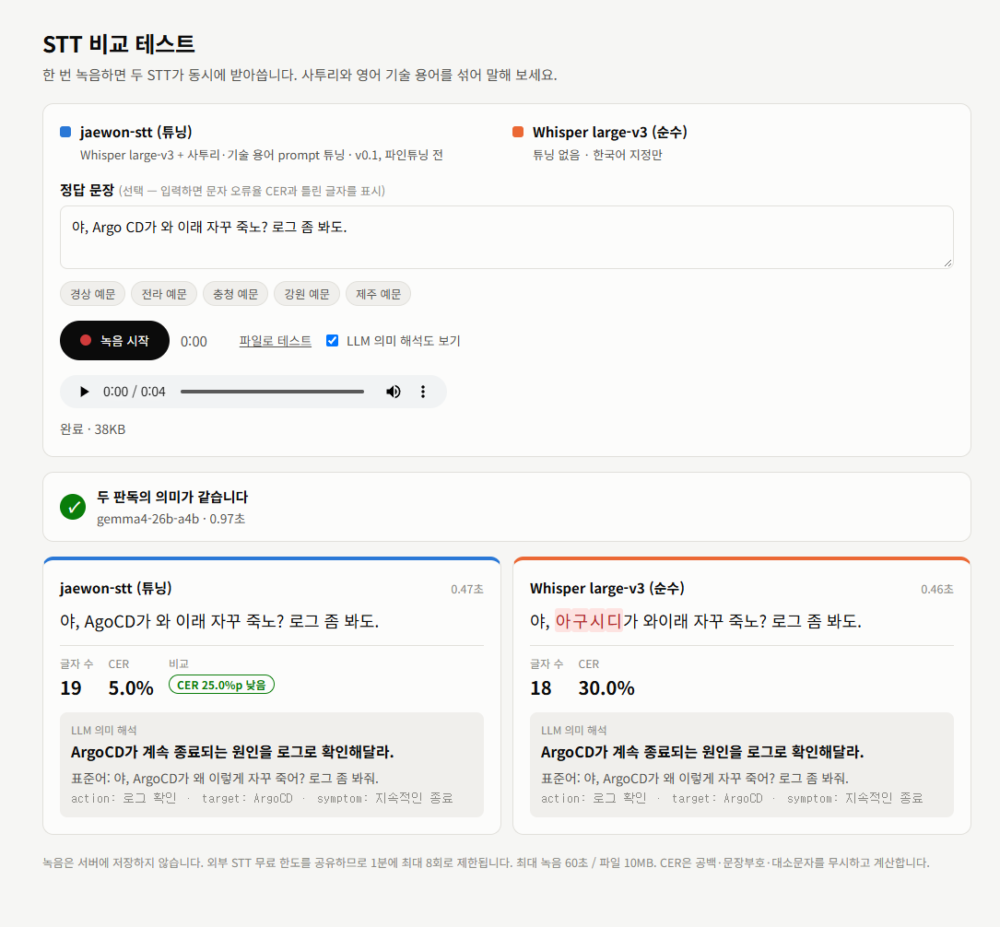
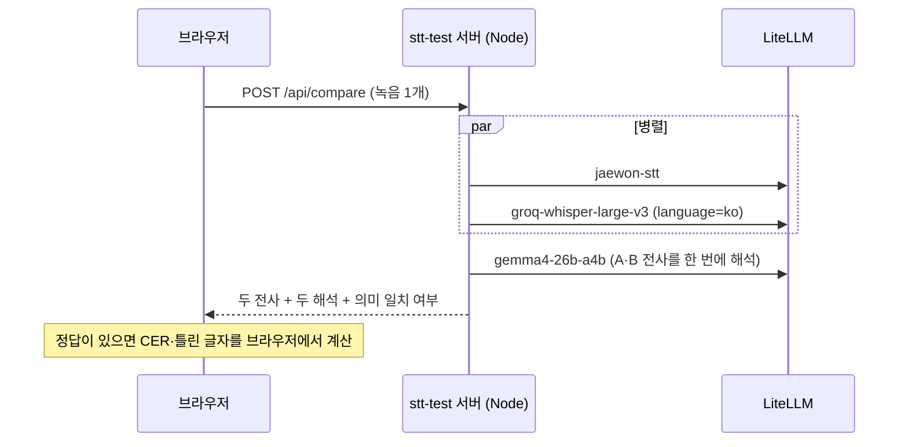
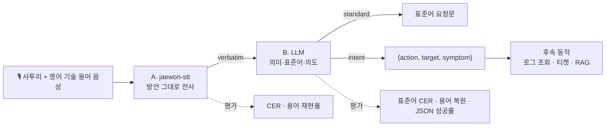
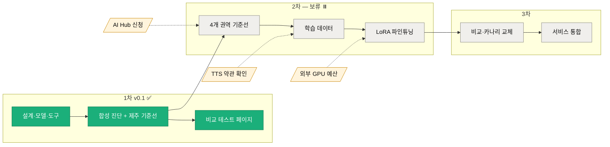
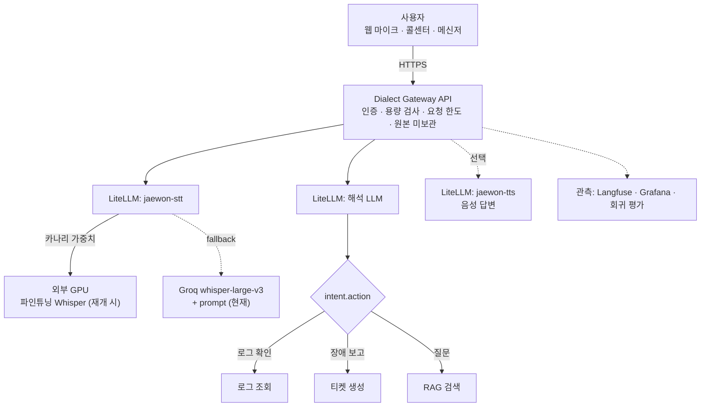

# korean-dialect-stt

경상·전라·충청·강원·제주 사투리와 영어 기술 용어가 섞인 말을 **들린 그대로 받아쓰고**, **표준어 요청과 의도(JSON)로 해석**하는 음성 이해 파이프라인.

> [!IMPORTANT]
> **v0.1.1 · 1차분 — 학습 미완료, 2차 보류**
> 기준선 측정·평가 체계·비교 테스트 페이지까지 완료했다. STT 파인튜닝은 수행하지 않았다.
> `jaewon-stt`는 학습된 모델이 아니라 Whisper에 사투리·기술 용어 prompt를 붙인 **임시 백엔드**이고, 아래 수치는 모두 학습 전 기준선이다.
> 2차(파인튜닝)는 비용·기간·데이터 절차 때문에 보류했다 → [6장](#6-진행-현황과-2차-보류)

```text
"야, Kubernetes Pod가 와 이래 자꾸 죽노? 로그 좀 봐도."       ← 사투리 + 영어 기술 용어
   │ A. jaewon-stt   들린 그대로 받아쓰기
   ▼
"야, Kubernetes Pod가 와 이래 자꾸 죽노? 로그 좀 봐도."
   │ B. LLM          의미 해석 + 표준어 + 의도
   ▼
"Kubernetes Pod가 왜 계속 종료되는지 로그를 확인해 주세요."
{"action": "로그 확인", "target": "Kubernetes Pod", "symptom": "잦은 종료"}
```

## 목차

1. [한눈에 보기](#1-한눈에-보기)
2. [비교 테스트 페이지](#2-비교-테스트-페이지)
3. [1차 결과](#3-1차-결과)
4. [설계](#4-설계)
5. [평가 방법](#5-평가-방법)
6. [진행 현황과 2차 보류](#6-진행-현황과-2차-보류)
7. [서비스 방법](#7-서비스-방법)
8. [사용 방법](#8-사용-방법)
9. [데이터와 라이선스](#9-데이터와-라이선스)
10. [한계](#10-한계)

---

## 1. 한눈에 보기

| 질문 | 답 | 근거 |
| --- | --- | --- |
| prompt 튜닝으로 기술 용어 문제가 풀리는가? | 절반. CER 47.8% → 25.3%, 용어 재현율 1.7% → 34.2% | [3-1](#3-1-prompt-효과는-데이터에-따라-다르다), [3-2](#3-2-기술-용어는-stt에서-대부분-사라지고-llm이-절반을-되살린다) |
| 일상 사투리에도 효과가 있는가? | 거의 없음. 실제 제주어 CER 30.1% → 28.5% | [3-1](#3-1-prompt-효과는-데이터에-따라-다르다), [3-4](#3-4-실제-제주어-문장별-분포) |
| LLM 해석 단계는 쓸모 있는가? | 그렇다. 잘못 받아쓴 용어를 2배로 복원(34.2% → 68.3%), 의도 JSON 100% | [3-2](#3-2-기술-용어는-stt에서-대부분-사라지고-llm이-절반을-되살린다), [2장](#2-비교-테스트-페이지) |
| 무엇을 학습해야 하는가? | ① 기술 용어 전사 ② 사투리를 표준어로 "고쳐 쓰는" 습성 ③ 제주어 고유 어휘 | [3-5](#3-5-stt-오류가-최종-품질을-얼마나-깎는가) |
| 2차는? | 보류. 권장안 약 30만 원·4~6주, 로컬 CPU는 수 주 + 운영 서비스 영향 | [6장](#6-진행-현황과-2차-보류) |

<picture>
  <source media="(prefers-color-scheme: dark)" srcset="docs/charts/dataset-cer-dark.svg">
  
</picture>

---

## 2. 비교 테스트 페이지

**https://stt-test.test-ai.cloud** — 한 번 녹음하면 튜닝 STT와 순수 STT가 동시에 받아쓰고, LLM이 두 결과의 의미를 해석해 같은 뜻인지 판정한다.



| 기능 | 설명 |
| --- | --- |
| 동시 받아쓰기 | 녹음(최대 60초) 또는 파일(10MB) 하나를 🟦 `jaewon-stt`(튜닝)와 🟧 `groq-whisper-large-v3`(순수, `language=ko`)에 병렬 전송, 처리 시간 표시 |
| 정답 비교 | 정답 문장(선택, 5개 권역 예문 버튼)을 넣으면 각 결과의 CER과 틀린 글자 강조, 더 나은 쪽에 "CER ○%p 낮음" |
| LLM 의미 해석 | 두 전사를 **한 번의** LLM 호출(`gemma4-26b-a4b`)에 넣어 카드마다 30자 이내 의미·표준어·의도 표시. 각 전사는 다른 쪽으로 보정하지 않고 받아쓴 그대로 해석 |
| 의미 일치 판정 | 두 해석이 같으면 ✓, 다르면 ≠와 핵심 차이(예: "대상 PostgreSQL vs Q&A") |



**실제 사이트 확인 사례** (합성 음성)

| 정답 | jaewon-stt (튜닝) | Whisper (순수) | LLM 판정 |
| --- | --- | --- | --- |
| 야, Argo CD가 와 이래 자꾸 죽노? 로그 좀 봐도. | 야, AgoCD가 와 이래 자꾸 죽노? … · **CER 5.0%** | 야, 아구시디가 와이래 자꾸 죽노? … · CER 30.0% | ✓ 같음 — 둘 다 "ArgoCD가 계속 종료되는 원인을 로그로 확인해달라" (LLM이 `아구시디` 복원) |
| PostgreSQL가 무사 자꾸 죽엄수과? 로그 좀 봐줍서. | 포스트그레스 QL가 무사 잡고 죽음습과… · **CER 48.0%** | 포스트그래스 Q&A가 무사 잡고 주검습과… · CER 56.0% | ≠ 다름 — 대상 PostgreSQL vs **Q&A** (순수 STT 오인식이 해석까지 바꿈) |

**구성과 운영** (`web/stt-test/`)

| 항목 | 내용 |
| --- | --- |
| 서버 | 의존성 없는 Node 22(`server.js`) + 단일 페이지(`index.html`). 녹음은 저장하지 않음 |
| 보안 | API 키는 Kubernetes Secret에서만 읽고 브라우저로 보내지 않음. 같은 Origin만 허용, IP당 분당 8회·동시 2건 제한(STT 무료 한도 보호), CSP 적용 |
| 배포 | `kubectl apply -k web/stt-test` 한 번. kustomize가 코드 내용 해시가 붙은 ConfigMap을 만들어 코드 변경 시 자동 롤링 업데이트 |
| 자동 복구 | Deployment(replicas 1)가 Pod를 관리 — Pod 삭제 후 2초 내 재생성, 노드·클러스터 재시작 후 자동 기동 |
| 노출 | 공유 NGINX Ingress(`nginx`) + 기존 `*.test-ai.cloud` 와일드카드 DNS |
| 키 연결 | `Set-SttTestKey.ps1` — 기존 통합 가상 키를 `stt-test/stt-test-litellm` Secret으로 복사(값 출력 없음). 최초 1회, 키 교체 시 재실행 |

---

## 3. 1차 결과

그래프는 `make_charts.py`가 `results/`에서 생성하며 GitHub 라이트/다크 테마를 따른다. 색은 구성마다 고정이다.

| 색 | 구성 |
| --- | --- |
| 🟧 주황 | Whisper 기본 (prompt 없음) — 비교 기준 |
| 🟦 파랑 | `jaewon-stt` (prompt 튜닝) — 1차 모델 |
| 🟪 보라 | `jaewon-stt` + LLM |
| 🟩 초록 | 정답 전사 + LLM (oracle) — LLM 단독 상한 |
| ⬚ 점선 | 파인튜닝 목표 (측정값 아님) |

### 3-1. prompt 효과는 데이터에 따라 다르다

[1장 그래프](#1-한눈에-보기) 참고.

- 기술 용어가 든 문장(합성 진단)에서는 prompt가 오류를 **−22.5%p**(47.8% → 25.3%) 줄였다.
- 기술 용어가 없는 실제 제주어 일상 발화에서는 **−1.6%p**(30.1% → 28.5%)에 그쳤다.
- prompt는 "용어 사전" 역할만 한다. 사투리 자체를 잘 받아쓰려면 **파인튜닝이 필요하다**.

### 3-2. 기술 용어는 STT에서 대부분 사라지고, LLM이 절반을 되살린다

<picture>
  <source media="(prefers-color-scheme: dark)" srcset="docs/charts/stage-term-funnel-dark.svg">
  
</picture>

- Whisper 기본은 용어를 거의 전부 한글 발음(`잉그레스`, `디플로이먼트`)으로 쓴다 → **1.7%**.
- prompt를 붙이면 **34.2%**, LLM이 `잉그레스 → Ingress`처럼 복원하면 **68.3%**.
- 정답 전사를 주면 LLM은 용어를 100% 지킨다 → 남은 31.7%p는 **STT 단계의 손실**이다.

### 3-3. 권역별 차이

<picture>
  <source media="(prefers-color-scheme: dark)" srcset="docs/charts/syn-cer-by-region-dark.svg">
  
</picture>

<picture>
  <source media="(prefers-color-scheme: dark)" srcset="docs/charts/syn-term-by-region-dark.svg">
  
</picture>

| 권역 | CER (기본 → jaewon) | 용어 재현율 (STT → LLM 후) | 표준어 CER |
| --- | --- | --- | --- |
| 경상 | 42.6% → **19.8%** | 29.2% → 66.7% | 33.0% |
| 강원 | 44.5% → 22.2% | 33.3% → 66.7% | **25.1%** |
| 제주 | 57.4% → 25.8% | **41.7% → 70.8%** | 30.7% |
| 충청 | 50.0% → 29.0% | 37.5% → 70.8% | 31.7% |
| 전라 | 44.4% → 29.6% | 29.2% → 66.7% | 48.2% |

- 모든 권역에서 같은 방향으로 개선됐다. 개선 폭은 제주(−31.6%p)가 가장 크고 전라(−14.8%p)가 가장 작다.
- ⚠️ **합성 음성 진단값**이다(억양 없음). 실음성 권역 비교는 AI Hub 데이터가 있어야 한다.

### 3-4. 실제 제주어 문장별 분포

<picture>
  <source media="(prefers-color-scheme: dark)" srcset="docs/charts/jeju-cer-histogram-dark.svg">
  
</picture>

- 실제 원어민 음성 150문장. 오류 40% 이상 문장은 **45건 → 32건**으로 줄었지만 30~40% 구간이 늘어 평균은 크게 변하지 않았다(중앙값 26.5%).
- 대표 오류는 Whisper가 사투리를 표준어로 **고쳐 쓰는** 것: `익숙헌 사름이 … 놓면` → `익숙한 사람이 … 놓으면`.

### 3-5. STT 오류가 최종 품질을 얼마나 깎는가

<picture>
  <source media="(prefers-color-scheme: dark)" srcset="docs/charts/std-cer-stt-cost-dark.svg">
  
</picture>

- 보라(STT 결과 → LLM)와 초록(정답 → LLM)의 차이가 **STT 오류 비용**이다.
- 합성 진단 **+11.5%p** — 표준어 오류의 약 ⅓이 STT에서 온다.
- 실제 제주어 **+8.4%p**, 그러나 LLM 단독도 44.2% → 제주어는 **LLM 번역 한계가 더 크다**(방언 사전·few-shot 필요).

---

## 4. 설계



| 비교 | 한 번에 표준어로 받아쓰기 | **두 단계 (이 프로젝트)** |
| --- | --- | --- |
| 정량 평가 | 발화와 정답이 달라 CER 측정 불가 | 단계별 CER 측정 |
| 오류 원인 | 인식 오류와 해석 오류가 섞임 | oracle 비교로 분리 ([3-5](#3-5-stt-오류가-최종-품질을-얼마나-깎는가)) |
| 환각 | 들리지 않은 표준어 생성 위험 | 전사는 들린 그대로, 해석은 문맥으로 |
| 원문 확인 | 원문 소실 | `verbatim`과 `standard` 동시 제공 |
| 모델 교체 | 전체 재학습 | STT·LLM 각각 교체 |

- **표기 규칙**: 영어 기술 용어는 라틴 문자(`Kubernetes Pod`)로 통일한다.
- **고정 이름**: 호출자는 `jaewon-stt`만 안다. 파인튜닝 모델이 생기면 LiteLLM 백엔드만 바꾼다.

| 이름 | 현재 백엔드 | 비고 |
| --- | --- | --- |
| `jaewon-stt` | Groq `whisper-large-v3` + `language=ko` + 사투리 어미·기술 용어 prompt | 학습 전 임시 |
| `jaewon-tts` | Google Cloud TTS `ko-KR-Standard-A` | 용어 합성 음성 생성 |
| 해석 LLM | `gemma4-26b-a4b` (자체 서버) | prompt만 사용 |

---

## 5. 평가 방법

| 지표 | 정의 | 좋은 방향 |
| --- | --- | --- |
| 방언 CER | 정답 방언 전사 대비 STT 결과의 문자 오류율 (편집 거리 ÷ 정답 길이) | ↓ |
| 용어 재현율 | 정답 기술 용어가 STT 결과에 영어 표기 그대로 들어간 비율 | ↑ |
| 정규화 후 용어 복원 | LLM 결과에 기술 용어가 살아 있는 비율 | ↑ |
| 표준어 CER | 정답 표준어 대비 LLM 결과의 문자 오류율 | ↓ |
| 의도 JSON 성공률 | `intent.action`이 있는 유효 JSON 비율 | ↑ |

- CER은 공백·문장부호·대소문자를 무시한다. 제주어 아래아(ᆞ/ᆢ)는 현대 모음(ㅏ/ㅕ)으로 바꿔 비교한다. 테스트 페이지도 같은 계산을 쓴다.
- **oracle 모드**: 정답 전사를 LLM에 바로 넣어 LLM 단독 성능을 잰다.

| 평가셋 | 합성 진단셋 | 실제 제주어 (JSS) |
| --- | --- | --- |
| 건수 | 120 (5개 권역 × 24) | 150 |
| 화자 | Google TTS Standard A~D (합성) | 제주어 원어민 1명 |
| 사투리 억양 | 없음 (어미·어휘만 사투리) | 있음 |
| 기술 용어 | 문장마다 1개 (12종) | 없음 |
| 표준어 정답 | 문장 틀에 함께 작성 | JIT 병렬 말뭉치 매칭 (149건) |
| 성격 | **진단** (기준선 아님) | **기준선** |

| # | 구성 | 평가셋 | 결과 파일 |
| --- | --- | --- | --- |
| ① | jaewon-stt + LLM (`request`) | 합성 | `results/2026-10-29-synthetic/report-jaewon-stt.json` |
| ② | Whisper 기본 (`language=ko`) | 합성 | `…/report-whisper-noprompt.json` |
| ③ | oracle + LLM | 합성 | `…/report-oracle-normalize.json` |
| ④⑤⑥ | 위와 동일 (`faithful`) | 실제 제주어 | `results/2026-10-29-jeju/summary.json` (집계만) |

---

## 6. 진행 현황과 2차 보류

### 6-1. 완료와 미완료

| 영역 | 항목 | 상태 |
| --- | --- | --- |
| 설계 | 2단계 구조, 표기 규칙, 고정 이름 `jaewon-stt`/`jaewon-tts` | ✅ 완료 |
| 도구 | 평가·증강·제주어 평가셋·그래프 스크립트 | ✅ 완료 |
| 평가 | 합성 진단 120건, 실제 제주어 150건 기준선 | ✅ 완료 |
| 서비스 | 비교 테스트 페이지 (동시 받아쓰기, CER, LLM 의미 해석·일치 판정) | ✅ 완료 |
| 평가 | 경상·전라·충청·강원 실음성 기준선 | ⏸️ 보류 — AI Hub 데이터 필요 |
| **학습** | **학습 데이터 구성, Whisper LoRA 파인튜닝, 해석 LLM 개선** | ⏸️ **보류** |
| 서비스 | 파인튜닝 모델 비교·카나리 교체, Dialect Gateway API | ⏸️ 보류 (설계만, [7장](#7-서비스-방법)) |



### 6-2. 2차를 보류한 이유

| 이유 | 내용 |
| --- | --- |
| 비용 | 외부 GPU·스토리지 등 일회성 **약 10~70만 원(권장 약 30만 원)**, 상시 서비스 시 월 수만 원(서버리스)~50~80만 원(상시 L4) 별도 |
| 기간 | **4~6주** — 실제 GPU 사용은 2~5일, 대부분은 데이터 승인·수신(권역별 수백 GB)·정리 |
| 외부 절차 | AI Hub 방언 데이터 신청·승인, TTS 출력의 학습 사용 약관 확인 |
| 로컬 CPU 대안 | 수 주 소요, 클러스터 운영 서비스(GitLab·Dify·MDAI·LiteLLM)를 같은 PC가 구동해 장기간 CPU 포화 시 서비스 영향 |

**2차 비용 추정** (실음성 약 300시간 + 표준어 약 100시간 + 용어 합성 ≤100시간, large-v3-turbo LoRA, 실험 3~5회 / 일반 클라우드 시세 기준, 결정 시점 재확인 필요)

| 항목 | 최소 | 권장 | 여유 |
| --- | --- | --- | --- |
| GPU 학습 (A100/L40S급) | 약 6만 원 (30시간) | 약 15만 원 (60시간) | 약 42만 원 (120시간) |
| 스토리지·전송 | 약 3만 원 | 약 7만 원 | 약 15만 원 |
| 서빙 테스트 GPU (L4급) | 약 1만 원 | 약 5만 원 | 약 10만 원 |
| TTS·평가 호출·AI Hub | 0원 | 0원 | 약 1만 원 |
| **합계** | **약 10만 원** | **약 30만 원** | **약 70만 원** |

**로컬 CPU 학습 추정** (AMD 8코어급, RAM 32GB, NVIDIA GPU 없음 · 실효 약 0.4~0.5 TFLOPS · turbo 30초 구간당 약 12~15초 · 이론 추정 ±2배)

| 방식 | 완료까지 | 기대 효과 |
| --- | --- | --- |
| A. 2차 계획 그대로 (전체 LoRA, 500시간) | **4주 ~ 2개월** | 목표 수준 |
| B. 인코더 고정 + 디코더만 학습 (인코더 출력 사전 계산, 디스크 약 230GB) | **약 5~7일** | 용어·방언 표기 습성에 유효, 억양 적응은 약함 |
| C. 데이터 50시간으로 축소 | 약 4~6일 | 일부 개선, 과적합 위험 |
| D. whisper-small 전체 학습 | 1~2주 | 기본 성능이 낮아 비추천 |
| 참고: 클라우드 A100 | 1~2일 | 목표 수준, 약 15만 원 |

### 6-3. 재개 조건과 목표

| 조건 | 재개 경로 |
| --- | --- |
| 외부 GPU 예산(권장 약 30만 원) 승인 | 원래 2차 계획 (4~6주) |
| AI Hub 방언 데이터 승인 | 4개 권역 기준선부터 (GPU 불필요) |
| 비용 없이 일부 개선 | 로컬 CPU B 방식 — 30분 실측 벤치마크 후 야간·코어 제한 실행 |

1차의 평가 도구·평가셋·그래프·테스트 페이지를 그대로 재사용하므로 재개 즉시 기준선과 비교할 수 있다.

<picture>
  <source media="(prefers-color-scheme: dark)" srcset="docs/charts/targets-higher-dark.svg">
  
</picture>

<picture>
  <source media="(prefers-color-scheme: dark)" srcset="docs/charts/targets-lower-dark.svg">
  
</picture>

| 지표 | 1차 (학습 전) | 재개 시 목표 | 근거 |
| --- | --- | --- | --- |
| 실음성 CER | 제주 28.5% | 기준선 대비 상대 30~50% 감소 | 방언형 정답 실음성 학습 |
| STT 용어 재현율 | 34.2% | 90% 이상 | 용어 집중 학습 + 라틴 표기 정답 |
| 정규화 후 용어 복원 | 68.3% | 95% 이상 | STT 개선 + oracle 상한 100% |
| 표준어 CER (합성) | 33.7% | oracle 수준 ≈22% | STT 오류 비용 제거 |

---

## 7. 서비스 방법



비교 테스트 페이지(2장)가 이 구조의 축소판이다(인증·후속 동작 제외).

**API (제안)**

```http
POST /v1/dialect/understand      multipart: file=<audio>, style=request|faithful

200 OK
{"verbatim": "야, Kubernetes Pod가 와 이래 자꾸 죽노? 로그 좀 봐도.",
 "standard": "Kubernetes Pod가 왜 계속 종료되는지 로그를 확인해 주세요.",
 "intent": {"action": "로그 확인", "target": "Kubernetes Pod", "symptom": "잦은 종료"},
 "models": {"stt": "jaewon-stt", "llm": "..."}, "latency_ms": {"stt": 820, "normalize": 640}}
```

| 서빙 방식 | 지연 | 비용 | 품질 | 시기 |
| --- | --- | --- | --- | --- |
| Groq Whisper + prompt | 낮음 | 무료 계층 / 사용량 과금 | 1차 기준선 | **현재** |
| 외부 GPU + 파인튜닝 Whisper | 중간 | GPU 시간 과금 | 목표 | 재개 시 |
| 하이브리드 (카나리 + fallback) | 낮음~중간 | 혼합 | 목표 + 가용성 | 전환 기간 |
| 온디바이스 (증류 모델) | 매우 낮음 | 단말 | 낮음 | 장기 검토 |

| 운영 영역 | 원칙 |
| --- | --- |
| 배치 | 추론은 클러스터 밖 GPU, 게이트웨이에는 엔드포인트만 등록 (faster-whisper 등 OpenAI 호환 서버) |
| 배포 | 같은 이름에 두 백엔드를 가중치로 등록해 10% → 50% → 100%, Groq 경로 fallback 유지 |
| 품질 | 모델·prompt 변경마다 고정 실음성 평가셋 회귀 평가, 악화 시 배포 중단 |
| 개인정보 | 녹음 원본 미보관, 로그에는 텍스트만(필요 시 마스킹), 외부 제공업체 보관 정책 확인 |
| 요청 한도 | 사용자·IP별 분당 요청·동시 처리 제한으로 제공업체 429 전파 방지 |
| 실시간 | VAD 0.5~1초 청크 부분 전사 → 발화 종료 시 전체 재전사 후 해석 |

---

## 8. 사용 방법

```bash
pip install -r requirements.txt
export LITELLM_BASE_URL=https://<litellm-gateway>/v1
export LITELLM_API_KEY=<virtual key>
```

| 작업 | 명령 |
| --- | --- |
| STT 호출 | `curl $LITELLM_BASE_URL/audio/transcriptions -H "Authorization: Bearer $LITELLM_API_KEY" -F model=jaewon-stt -F file=@sample.wav` |
| 합성 진단셋 생성 | `python synthesize_augmentation.py --limit 120 --execute --out runs/syn` (기본은 dry run) |
| 합성 진단 평가 | `python evaluate_baseline.py runs/syn/manifest.jsonl --diagnostic --stt-model jaewon-stt --llm-model <LLM> --delay 3.5` |
| prompt 없는 비교 | `python evaluate_baseline.py runs/syn/manifest.jsonl --diagnostic --stt-model groq-whisper-large-v3 --language ko --skip-normalize` |
| LLM 단독 (oracle) | `python evaluate_baseline.py runs/syn/manifest.jsonl --diagnostic --oracle --llm-model <LLM>` |
| 제주어 평가셋 구성 | `python prepare_jss.py --count 150 --out runs/jeju` (4.4GB 중 필요한 클립만 수신) |
| 제주어 평가 | `python evaluate_baseline.py runs/jeju/manifest.jsonl --stt-model jaewon-stt --llm-model <LLM> --prompt faithful` |
| 그래프 재생성 | `python make_charts.py` |
| 테스트 페이지 배포 | `kubectl apply -k web/stt-test` → 최초 1회 `powershell -File web/stt-test/Set-SttTestKey.ps1` |
| LiteLLM 모델 등록 | `kubectl -n litellm exec -i deploy/litellm -- python - < litellm/register_jaewon_audio.py` |

manifest 형식 (JSONL):

```json
{"audio": "clips/gs-0001.wav", "region": "gyeongsang", "verbatim": "야, Kubernetes Pod가 와 이래 자꾸 죽노? 로그 좀 봐도.",
 "standard": "Kubernetes Pod가 왜 계속 종료되는지 로그를 확인해 주세요.", "terms": ["Kubernetes", "Pod"], "synthetic": false}
```

- 합성 행(`synthetic: true`)이 든 manifest는 `--diagnostic` 없이는 평가를 거부한다.
- Groq 무료 계층은 분당 요청 수 제한이 있다. 다른 서비스와 키를 공유하면 `--delay 3.5` 이상으로 순차 실행한다.

```text
korean-dialect-stt/
├── README.md · CHANGELOG.md
├── evaluate_baseline.py          # 평가 (STT + 정규화, 권역별 지표)
├── synthesize_augmentation.py    # jaewon-tts 학습용 합성 음성 (기본 dry run)
├── prepare_jss.py                # 공개 제주어 음성 평가셋 구성
├── make_charts.py                # results/ → docs/charts/ 그래프
├── data/                         # 사투리 문장 틀, 기술 용어
├── litellm/register_jaewon_audio.py
├── web/stt-test/                 # 비교 테스트 페이지 (server.js, index.html, kustomize, 키 스크립트)
├── docs/charts/ · docs/images/
└── results/2026-10-29-synthetic/ · results/2026-10-29-jeju/
```

---

## 9. 데이터와 라이선스

| 데이터 | 용도 | 라이선스 | 저장소 포함 |
| --- | --- | --- | --- |
| 사투리 문장 틀 10개 × 기술 용어 12개 (`data/`) | 합성 진단·증강 | 본 프로젝트 | 포함 |
| 합성 진단 manifest·보고서 | 결과 | 본 프로젝트 (음성 제외) | 포함 |
| [Kakao Brain JSS](https://github.com/kakaobrain/jejueo) 제주어 음성 | 실음성 평가 | **CC BY-NC-SA 4.0** | 미포함 — `prepare_jss.py`로 재구성 |
| [Kakao Brain JIT](https://github.com/kakaobrain/jejueo) 제주어-표준어 병렬 | 표준어 정답 | **CC BY-NC-SA 4.0** | 미포함 |
| AI Hub 지역별 방언 발화 (5개 권역) | 학습·평가 (재개 시) | AI Hub 약관 | 미확보 |

- JSS/JIT는 **비상업 평가 용도로만** 쓰며 상용 모델 학습에 쓰지 않는다. 출처: Park, Choe, Ham, *Jejueo Datasets for Machine Translation and Speech Synthesis*, LREC 2020.
- TTS 합성 음성은 사투리 억양을 재현하지 못하므로 기술 용어 노출용으로만 쓰고(학습 데이터의 30% 이하), 평가셋에는 넣지 않는다.

---

## 10. 한계

- **학습 미완료**: 모든 수치는 파인튜닝 전 기준선이다.
- 합성 진단셋은 억양이 없고 화자가 적다. 실음성 기준선은 제주어 **단일 화자 150문장**뿐이다.
- 용어 재현율은 부분 문자열 일치라 `ArgoCD`와 `Argo CD`를 다르게 집계한다.
- 표준어 CER은 의역에 민감하다. 의미 일치는 테스트 페이지의 LLM 판정으로 정성 확인만 가능하다.
- 제주어 아래아 변환(ᆞ→ㅏ, ᆢ→ㅕ)은 근사치다.
- 테스트 페이지는 공개 주소이며 STT 무료 한도를 공유한다(IP당 분당 8회 제한).

---

*v0.1.1 · 2026-10-29 · 1차분(기준선·평가 체계·비교 테스트 페이지) — 파인튜닝 미완료, 2차 보류. 변경 이력은 [CHANGELOG.md](CHANGELOG.md).*
