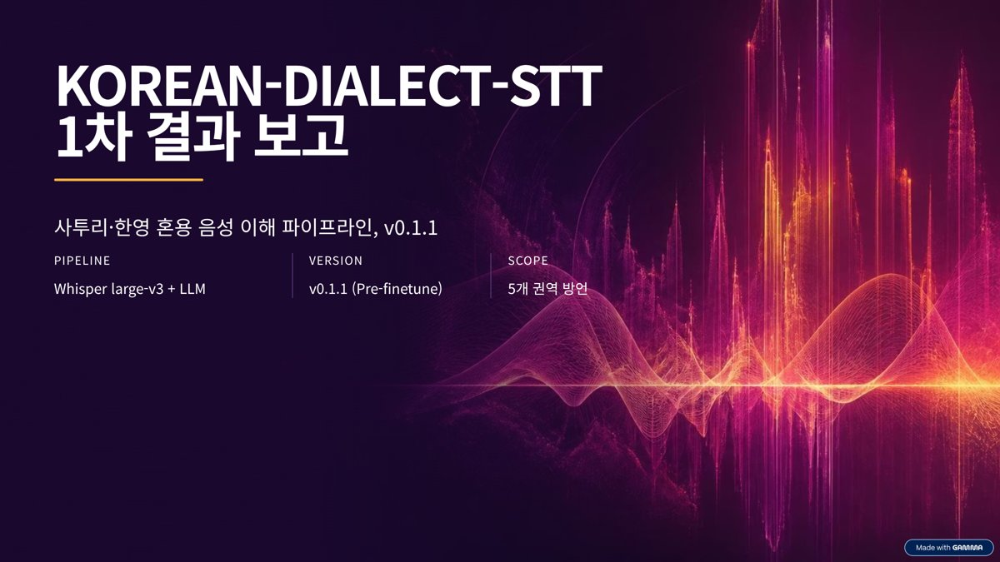
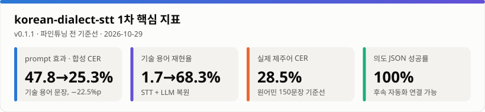
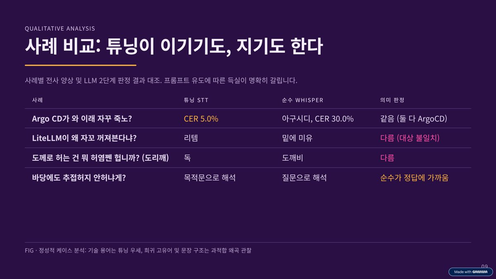
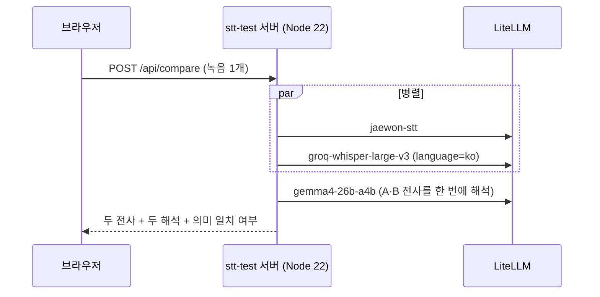
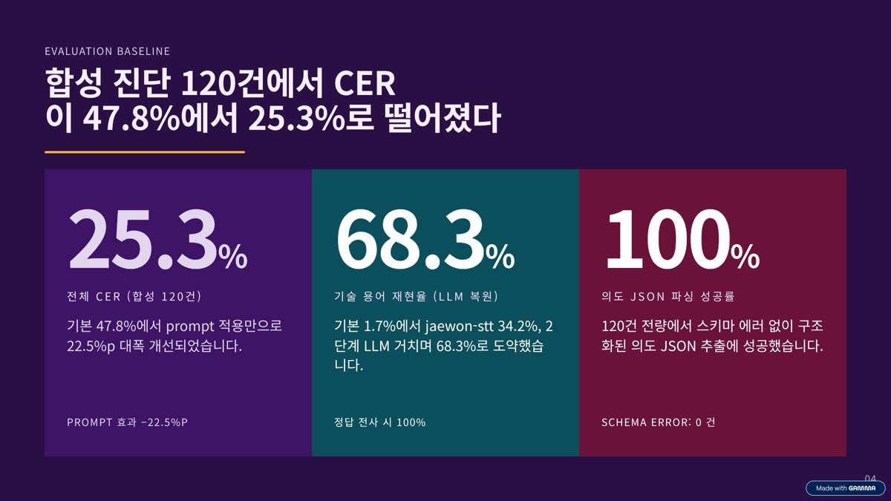
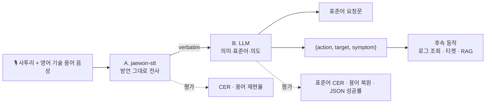
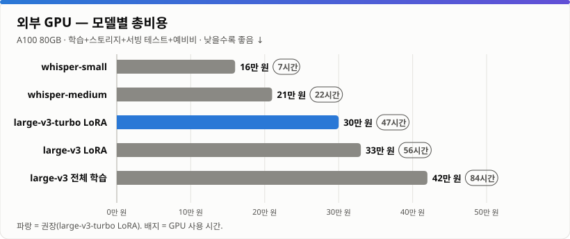
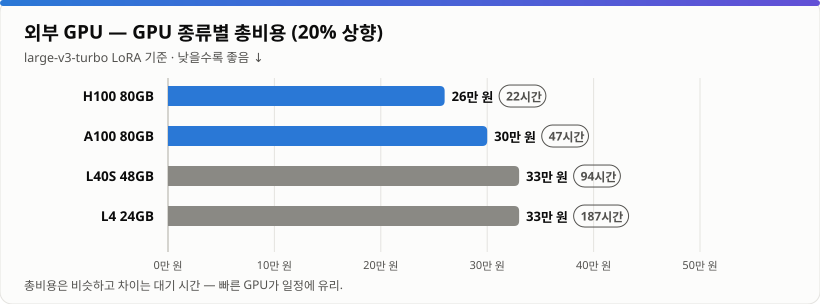
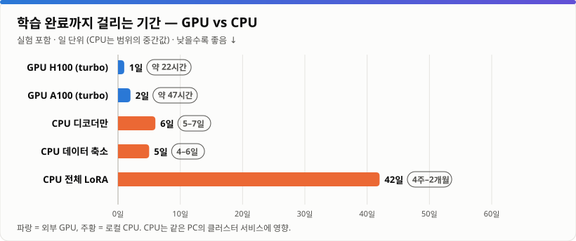
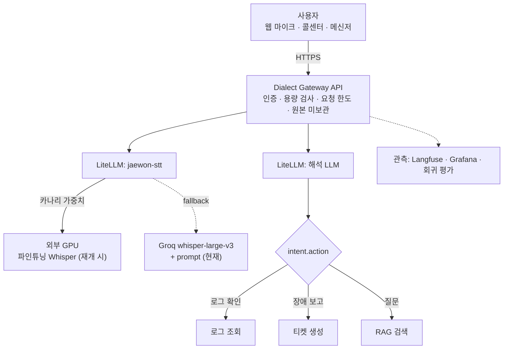

<div align="center">



# korean-dialect-stt

**사투리 + 영어 기술 용어가 섞인 말을 들린 그대로 받아쓰고, 의미·표준어·의도로 해석하는 음성 이해 파이프라인**

`v0.1.1` · 1차 완료 · 파인튜닝 전 기준선 · 2차 보류

[🎙️ 비교 테스트 페이지](https://stt-test.test-ai.cloud) · [📊 발표 자료 (Gamma)](https://gamma.app/docs/ph9nxtr6waspgpm) · [🎨 요약 인포그래픽 (Canva)](https://canva.link/23vep8wd4iy0qfd)

</div>

> [!IMPORTANT]
> **학습 미완료.** `jaewon-stt`는 학습된 모델이 아니라 Whisper large-v3에 사투리·기술 용어 prompt를 붙인 임시 백엔드이며, 모든 수치는 파인튜닝 전 기준선이다. 2차(파인튜닝)는 [GPU·CPU 검토](#5-2차-보류--gpu와-cpu-검토) 결과 보류했다.

```text
"야, Kubernetes Pod가 와 이래 자꾸 죽노? 로그 좀 봐도."        사투리 + 영어 기술 용어
   │  A. jaewon-stt   들린 그대로 받아쓰기
   ▼
"야, Kubernetes Pod가 와 이래 자꾸 죽노? 로그 좀 봐도."
   │  B. LLM          의미 해석 + 표준어 + 의도
   ▼
"Kubernetes Pod가 왜 계속 종료되는지 로그를 확인해 주세요."   {"action": "로그 확인", "target": "Kubernetes Pod", "symptom": "잦은 종료"}
```

## 목차

1. [핵심 지표](#1-핵심-지표)
2. [비교 테스트 페이지](#2-비교-테스트-페이지)
3. [1차 결과](#3-1차-결과)
4. [설계와 평가 방법](#4-설계와-평가-방법)
5. [2차 보류 — GPU와 CPU 검토](#5-2차-보류--gpu와-cpu-검토)
6. [서비스 방법](#6-서비스-방법)
7. [사용 방법](#7-사용-방법)
8. [데이터·라이선스·한계](#8-데이터라이선스한계)

---

## 1. 핵심 지표

<picture>
  <source media="(prefers-color-scheme: dark)" srcset="docs/charts/kpi-dark.svg">
  
</picture>

| 질문 | 답 |
| --- | --- |
| prompt 튜닝으로 기술 용어 문제가 풀리는가? | **절반.** CER 47.8% → 25.3%, 용어 재현율 1.7% → 34.2% |
| 일상 사투리에도 효과가 있는가? | **거의 없음.** 실제 제주어 CER 30.1% → 28.5% |
| LLM 해석 단계는 쓸모 있는가? | **그렇다.** 잘못 받아쓴 용어를 2배로 복원(34.2% → 68.3%), 의도 JSON 100% |
| 무엇을 학습해야 하는가? | ① 기술 용어 전사 ② 사투리를 표준어로 "고쳐 쓰는" 습성 ③ 제주어 고유 어휘 |
| 2차는? | **보류.** GPU 권장안 약 30만 원·5–7주 / 로컬 CPU 수 주 + 운영 서비스 영향 |

---

## 2. 비교 테스트 페이지

**https://stt-test.test-ai.cloud** — 한 번 녹음하면 튜닝 STT와 순수 STT가 동시에 받아쓰고, LLM이 두 결과의 의미를 해석해 같은 뜻인지 판정한다.


| 기능 | 설명 |
| --- | --- |
| 동시 받아쓰기 | 녹음(최대 60초) 또는 파일(10MB) 하나를 🟦 `jaewon-stt`(튜닝)와 🟧 `groq-whisper-large-v3`(순수, `language=ko`)에 병렬 전송 |
| 정답 비교 | 정답 문장(선택, 5개 권역 예문 버튼)을 넣으면 CER과 틀린 글자 강조, 더 나은 쪽에 "CER ○%p 낮음" |
| LLM 의미 해석 | 두 전사를 **한 번의** LLM 호출(`gemma4-26b-a4b`)로 해석 — 카드마다 30자 이내 의미·표준어·의도 |
| 의미 일치 판정 | 같으면 ✓, 다르면 ≠와 핵심 차이 |

### 실제 사이트에서 추출한 사례

36건(합성 영문 혼합 16건 + 실제 제주어 20건)을 실제 사이트에 돌려 성공한 34건(2건은 일시 오류·한도 초과) 중 의미 판정이 갈린 사례를 골랐다.



| 구분 | 정답 (의미) | 🟦 jaewon-stt (튜닝) | 🟧 Whisper (순수) | LLM 판정 |
| --- | --- | --- | --- | --- |
| 영문 혼합 · 경상 | 야, **Argo CD**가 와 이래 자꾸 죽노? | AgoCD · CER **5.0%** | **아구시디** · CER 30.0% | ✓ 같음 — LLM이 `아구시디`를 ArgoCD로 복원 |
| 영문 혼합 · 제주 | **PostgreSQL**가 무사 자꾸 죽엄수과? | 포스트그레스 QL · CER **48.0%** | 포스트그래스 **Q&A** · CER 56.0% | ≠ 대상 PostgreSQL vs **Q&A** |
| **영문 혼합 · 전라** | **LiteLLM**이 왜 자꼬 꺼져븐다냐? 쪼까 봐주랑께. (LiteLLM이 왜 계속 꺼지는지) | **리템**이 왜 자꾸 꺼져분다냐? | **밑에 미유**에 자꾸 꺼져 본다냐? | ≠ 대상 "리템" vs "밑에 미유" — 둘 다 틀렸지만 튜닝 쪽이 원래 단어에 가깝다 |
| **실제 제주어 ①** | **도께**로 허는 건 뭐 허염쩬 헙니까? (**도리깨**로 하는 건 뭐 한다고 합니까) | **독괴**로 허는 건… → "**독**으로 하는 것" | **도깨**로 하는 건… → "**도깨비**로 하는 것" | ≠ 대상 독 vs 도깨비 — 둘 다 "도리깨"를 놓침 (제주어 고유 어휘) |
| **실제 제주어 ②** | 이제 바당에도 추접허지 **안허냐게?** (바다에도 더럽지 **않니?**) | 추접하지 **않으나게,** → "더러워지지 않도록 하겠다" | 추접하지 **않으냐는 게** → "더러워지지 않느냐고 묻는 내용" | ≠ 목적 vs 질문 — **순수 쪽이 정답에 가깝다** |

- 기술 용어가 든 문장에서는 튜닝이 유리하고, 제주어 고유 어휘·어미에서는 튜닝 이점이 없거나 오히려 불리했다 → [3-1](#3-1-prompt-효과는-데이터에-따라-다르다)의 정량 결과와 같은 결론이다.
- 제주어 사례는 Kakao Brain JSS(CC BY-NC-SA 4.0) 문장을 출처 표기 하에 인용했다. 같은 조건에서 강원 "PostgreSQL 고거 아직 안 됐드래요?"는 튜닝 쪽이 물음표를 놓쳐 평서문으로 해석된 반대 사례도 있었다.

### 구성과 운영 (`web/stt-test/`)



| 항목 | 내용 |
| --- | --- |
| 서버 | 의존성 없는 Node 22(`server.js`) + 단일 페이지(`index.html`). 녹음은 저장하지 않음 |
| 보안 | API 키는 Kubernetes Secret에서만 읽음. 같은 Origin만 허용, IP당 분당 8회·동시 2건 제한, CSP 적용 |
| 배포 | `kubectl apply -k web/stt-test` — 코드 내용 해시 ConfigMap으로 코드 변경 시 자동 롤링 업데이트 |
| 자동 복구 | Deployment가 Pod 관리 — Pod 삭제 후 2초 내 재생성, 재부팅 후 자동 기동 |
| 키 연결 | `Set-SttTestKey.ps1` — 기존 통합 가상 키를 Secret으로 복사(값 출력 없음). 최초 1회, 키 교체 시 재실행 |

---

## 3. 1차 결과

색은 구성마다 고정이다 — 🟧 Whisper 기본 · 🟦 jaewon-stt · 🟪 jaewon-stt + LLM · 🟩 정답 전사 + LLM(oracle) · ⬚ 목표. 모든 그래프는 `make_charts.py`가 `results/`에서 생성하며 GitHub 라이트/다크 테마를 따른다.



### 3-1. prompt 효과는 데이터에 따라 다르다

<picture>
  <source media="(prefers-color-scheme: dark)" srcset="docs/charts/dataset-cer-dark.svg">
  
</picture>

기술 용어 문장에서는 **−22.5%p**, 일상 제주어에서는 **−1.6%p**. prompt는 "용어 사전" 역할만 하며, 사투리 자체는 파인튜닝이 필요하다.

### 3-2. 기술 용어는 STT에서 대부분 사라지고, LLM이 절반을 되살린다

<picture>
  <source media="(prefers-color-scheme: dark)" srcset="docs/charts/stage-term-funnel-dark.svg">
  
</picture>

Whisper 기본은 용어를 거의 전부 한글 발음(`잉그레스`, `디플로이먼트`)으로 쓴다(1.7%). prompt로 34.2%, LLM 복원으로 68.3%. 정답을 주면 LLM은 100%를 지키므로, 남은 31.7%p는 **STT 단계의 손실**이다.

### 3-3. 권역별 차이

<picture>
  <source media="(prefers-color-scheme: dark)" srcset="docs/charts/syn-cer-by-region-dark.svg">
  
</picture>

<picture>
  <source media="(prefers-color-scheme: dark)" srcset="docs/charts/syn-term-by-region-dark.svg">
  
</picture>

모든 권역이 같은 방향으로 개선됐고 폭은 제주(−31.6%p)가 가장 크다. 합성 음성 진단값(억양 없음)이라 실음성 권역 비교는 AI Hub 데이터가 필요하다.

### 3-4. 실제 제주어 문장별 분포

<picture>
  <source media="(prefers-color-scheme: dark)" srcset="docs/charts/jeju-cer-histogram-dark.svg">
  
</picture>

오류 40% 이상 문장은 45건 → 32건으로 줄었지만 평균은 거의 같다(중앙값 26.5%). 대표 오류는 사투리를 표준어로 고쳐 쓰는 것: `익숙헌 사름이 … 놓면` → `익숙한 사람이 … 놓으면`.

### 3-5. STT 오류가 최종 품질을 얼마나 깎는가

<picture>
  <source media="(prefers-color-scheme: dark)" srcset="docs/charts/std-cer-stt-cost-dark.svg">
  
</picture>

STT 오류 비용은 합성 **+11.5%p**, 제주 **+8.4%p**. 제주어는 LLM 단독도 44.2%라 **LLM 번역 한계가 더 크다**(방언 사전·few-shot 필요).

---

## 4. 설계와 평가 방법



| 왜 두 단계인가 | 한 번에 표준어로 받아쓰기 | **두 단계 (이 프로젝트)** |
| --- | --- | --- |
| 정량 평가 | 발화와 정답이 달라 CER 측정 불가 | 단계별 CER 측정 |
| 오류 원인 | 인식·해석 오류가 섞임 | oracle 비교로 분리 |
| 환각 | 들리지 않은 표준어 생성 위험 | 전사는 들린 그대로, 해석은 문맥으로 |
| 모델 교체 | 전체 재학습 | STT·LLM 각각 교체 (고정 이름 `jaewon-stt`) |

| 구성 요소 | 현재 백엔드 |
| --- | --- |
| `jaewon-stt` | Groq `whisper-large-v3` + `language=ko` + 사투리 어미·기술 용어 prompt (학습 전) |
| `jaewon-tts` | Google Cloud TTS `ko-KR-Standard-A` (용어 합성 음성 생성) |
| 해석 LLM | `gemma4-26b-a4b` (자체 서버, prompt만 사용) |

| 지표 | 정의 |
| --- | --- |
| 방언 CER ↓ | 정답 방언 전사 대비 문자 오류율 (공백·문장부호·대소문자 무시, 아래아 ᆞ/ᆢ → ㅏ/ㅕ) |
| 용어 재현율 ↑ | 정답 기술 용어가 영어 표기 그대로 남은 비율 |
| 정규화 후 용어 복원 ↑ | LLM 결과에 기술 용어가 살아 있는 비율 |
| 표준어 CER ↓ | 정답 표준어 대비 LLM 결과의 문자 오류율 |
| 의도 JSON 성공률 ↑ | `intent.action`이 있는 유효 JSON 비율 |

| 평가셋 | 합성 진단셋 | 실제 제주어 (JSS) |
| --- | --- | --- |
| 규모 | 120건 (5개 권역 × 24) | 150문장 |
| 화자 | Google TTS Standard A–D | 제주어 원어민 1명 |
| 억양 / 기술 용어 | 없음 / 문장마다 1개 | 있음 / 없음 |
| 성격 | **진단** (기준선 아님) | **기준선** |

---

## 5. 2차 보류 — GPU와 CPU 검토

| 상태 | 항목 |
| --- | --- |
| ✅ 완료 | 2단계 설계, `jaewon-stt`/`jaewon-tts`, 평가·증강·그래프 도구, 합성 진단 + 제주 기준선, 비교 테스트 페이지 |
| ⏸️ 보류 | 4개 권역 실음성 기준선, 학습 데이터 구성, Whisper 파인튜닝, 해석 LLM 개선, 카나리 교체, Dialect Gateway API |

### 5-1. 외부 GPU 경로 (시간·비용 20% 상향 추정)

> 기준: A100 80GB $2.0/시간(시세 상단), 환율 1,450원, 데이터 약 500시간, 실험 4회 + 준비·대기 30%, 공통비(스토리지 300GB×2개월·서빙 테스트) 포함, 예비비 20%, **여기에 시간과 비용을 다시 20% 상향**. 결정 시점에 업체 가격 재확인 필요.

<picture>
  <source media="(prefers-color-scheme: dark)" srcset="docs/charts/gpu-cost-by-model-dark.svg">
  
</picture>

| 모델 / 방식 | GPU 사용 | 총비용 | 평가 |
| --- | --- | --- | --- |
| whisper-small 전체 학습 | 약 7시간 | 약 16만 원 | 한국어 기본 성능 부족 |
| whisper-medium 전체 학습 | 약 22시간 | 약 21만 원 | 보통 |
| **large-v3-turbo LoRA** | **약 47시간** | **약 30만 원** | **권장** — 서비스 추론도 빠름 |
| large-v3 LoRA | 약 56시간 | 약 33만 원 | 추론은 turbo보다 약 2배 느림 |
| large-v3 전체 학습 | 약 84시간 | 약 42만 원 | 최대 품질, 80GB급 필요 |

<picture>
  <source media="(prefers-color-scheme: dark)" srcset="docs/charts/gpu-cost-by-type-dark.svg">
  
</picture>

| 일정 | 기간 |
| --- | --- |
| AI Hub 승인·수신·정리 | 1–2주 |
| 학습 데이터 구성 | 약 1주 |
| GPU 학습 (turbo 기준) | 3–4일 |
| 비교 평가·문서·테스트 페이지 연결 | 약 1주 |
| **합계** | **5–7주** |
| 상시 서비스 (별도) | L4 1대 월 약 77만 원 / 서버리스는 사용량 비례 |

**GPU 경로를 보류한 이유**: 외부 GPU 예산(권장 약 30만 원)과 결제 결정, AI Hub 데이터 신청·승인, TTS 출력의 학습 사용 약관 확인이 선행돼야 한다.

### 5-2. 로컬 CPU 경로

> 기준: AMD 8코어급 CPU(Radeon 780M 내장 그래픽), RAM 32GB, NVIDIA GPU 없음. 실효 약 0.4–0.5 TFLOPS(A100의 1/100 이하), large-v3-turbo 30초 구간 학습에 약 12–15초. 이론 추정(±2배).

<picture>
  <source media="(prefers-color-scheme: dark)" srcset="docs/charts/gpu-vs-cpu-days-dark.svg">
  
</picture>

| 방식 | 완료까지 | 기대 효과 |
| --- | --- | --- |
| 전체 LoRA (500시간) | **4주–2개월** | 목표 수준 |
| 인코더 고정 + 디코더만 학습 (인코더 출력 사전 계산, 디스크 약 230GB) | 5–7일 | 용어·방언 표기 습성에 유효, 억양 적응은 약함 |
| 데이터 50시간으로 축소 | 4–6일 | 일부 개선, 과적합 위험 |
| whisper-small 전체 학습 | 1–2주 | 기본 성능이 낮아 비추천 |

**CPU 경로를 보류한 이유**: 같은 PC가 Kubernetes 클러스터(GitLab·Dify·MDAI·LiteLLM)를 구동하므로 수 일–수 주간 CPU를 포화시키면 서비스가 느려지거나 끊긴다. 내장 GPU(Radeon 780M)는 Windows에서 ROCm 공식 지원 대상이 아니라 학습에 쓸 수 없다. 데이터 신청·약관 절차는 GPU 경로와 똑같이 필요하다.

### 5-3. 재개 조건과 목표

| 조건 | 재개 경로 |
| --- | --- |
| 외부 GPU 예산 승인 | large-v3-turbo LoRA (약 30만 원, 5–7주) |
| AI Hub 방언 데이터 승인 | 4개 권역 기준선부터 (GPU 불필요) |
| 비용 없이 일부 개선 | CPU 디코더 학습 — 30분 실측 벤치마크 후 야간·코어 제한 실행 |

<picture>
  <source media="(prefers-color-scheme: dark)" srcset="docs/charts/targets-higher-dark.svg">
  
</picture>

<picture>
  <source media="(prefers-color-scheme: dark)" srcset="docs/charts/targets-lower-dark.svg">
  
</picture>

목표치는 계획이며 측정값이 아니다. 1차의 평가 도구·평가셋·그래프·테스트 페이지를 그대로 재사용하므로 재개 즉시 기준선과 비교할 수 있다.

---

## 6. 서비스 방법



비교 테스트 페이지가 이 구조의 축소판이다(인증·후속 동작 제외).

```http
POST /v1/dialect/understand      multipart: file=<audio>

200 OK
{"verbatim": "야, Kubernetes Pod가 와 이래 자꾸 죽노? 로그 좀 봐도.",
 "standard": "Kubernetes Pod가 왜 계속 종료되는지 로그를 확인해 주세요.",
 "intent": {"action": "로그 확인", "target": "Kubernetes Pod", "symptom": "잦은 종료"}}
```

| 운영 영역 | 원칙 |
| --- | --- |
| 배치 | 추론은 클러스터 밖 GPU, 게이트웨이에는 엔드포인트만 등록 (faster-whisper 등 OpenAI 호환 서버) |
| 배포 | 같은 이름에 두 백엔드를 가중치로 등록해 10% → 50% → 100%, Groq 경로 fallback 유지 |
| 품질 | 모델·prompt 변경마다 고정 실음성 평가셋 회귀 평가, 악화 시 배포 중단 |
| 개인정보 | 녹음 원본 미보관, 로그에는 텍스트만, 외부 제공업체 보관 정책 확인 |
| 요청 한도 | 사용자·IP별 분당 요청·동시 처리 제한으로 제공업체 429 전파 방지 |

---

## 7. 사용 방법

```bash
pip install -r requirements.txt
export LITELLM_BASE_URL=https://<litellm-gateway>/v1
export LITELLM_API_KEY=<virtual key>
```

| 작업 | 명령 |
| --- | --- |
| STT 호출 | `curl $LITELLM_BASE_URL/audio/transcriptions -H "Authorization: Bearer $LITELLM_API_KEY" -F model=jaewon-stt -F file=@sample.wav` |
| 합성 진단셋 생성 | `python synthesize_augmentation.py --limit 120 --execute --out runs/syn` (기본은 dry run) |
| 합성 진단 평가 | `python evaluate_baseline.py runs/syn/manifest.jsonl --diagnostic --stt-model jaewon-stt --llm-model <LLM> --delay 3.5` |
| prompt 없는 비교 | `python evaluate_baseline.py runs/syn/manifest.jsonl --diagnostic --stt-model groq-whisper-large-v3 --language ko --skip-normalize` |
| LLM 단독 (oracle) | `python evaluate_baseline.py runs/syn/manifest.jsonl --diagnostic --oracle --llm-model <LLM>` |
| 제주어 평가셋 | `python prepare_jss.py --count 150 --out runs/jeju` → `evaluate_baseline.py … --prompt faithful` |
| 그래프 재생성 | `python make_charts.py` |
| 테스트 페이지 배포 | `kubectl apply -k web/stt-test` → 최초 1회 `powershell -File web/stt-test/Set-SttTestKey.ps1` |
| LiteLLM 모델 등록 | `kubectl -n litellm exec -i deploy/litellm -- python - < litellm/register_jaewon_audio.py` |

```text
korean-dialect-stt/
├── README.md                     # 유일한 문서
├── evaluate_baseline.py          # 평가 (STT + 해석, 권역별 지표)
├── synthesize_augmentation.py    # jaewon-tts 학습용 합성 음성 (기본 dry run)
├── prepare_jss.py                # 공개 제주어 음성 평가셋 구성
├── make_charts.py                # results/ → docs/charts/ 그래프
├── data/                         # 사투리 문장 틀, 기술 용어
├── litellm/register_jaewon_audio.py
├── web/stt-test/                 # 비교 테스트 페이지 (Node 서버, 페이지, kustomize, 키 스크립트)
├── docs/charts/ · docs/images/   # 그래프 SVG, 화면·발표 이미지
└── results/                      # 합성 진단 보고서, 제주어 집계
```

---

## 8. 데이터·라이선스·한계

| 데이터 | 용도 | 라이선스 | 저장소 포함 |
| --- | --- | --- | --- |
| 사투리 문장 틀 10개 × 기술 용어 12개 | 합성 진단·증강 | 본 프로젝트 | 포함 |
| 합성 진단 manifest·보고서 | 결과 | 본 프로젝트 (음성 제외) | 포함 |
| [Kakao Brain JSS](https://github.com/kakaobrain/jejueo) 제주어 음성 | 실음성 평가 | **CC BY-NC-SA 4.0** | 미포함 (`prepare_jss.py`로 재구성) |
| [Kakao Brain JIT](https://github.com/kakaobrain/jejueo) 제주어-표준어 병렬 | 표준어 정답 | **CC BY-NC-SA 4.0** | 미포함 |
| AI Hub 지역별 방언 발화 | 학습·평가 (재개 시) | AI Hub 약관 | 미확보 |

- JSS/JIT는 비상업 평가 용도로만 쓴다. 출처: Park, Choe, Ham, *Jejueo Datasets for Machine Translation and Speech Synthesis*, LREC 2020.
- TTS 합성 음성은 억양을 재현하지 못하므로 용어 노출용으로만 쓰고(학습 데이터의 30% 이하) 평가셋에 넣지 않는다.

**한계**: 모든 수치는 파인튜닝 전 기준선이다. 합성 진단셋은 억양이 없고, 실음성 기준선은 제주어 단일 화자 150문장뿐이다. 용어 재현율은 부분 문자열 일치(`ArgoCD` ≠ `Argo CD`)이고 표준어 CER은 의역에 민감하다. 아래아 변환은 근사치다. 테스트 페이지는 공개 주소이며 STT 무료 한도를 공유한다.

---

<div align="center">

**v0.1.1** · 2026-10-29 · v0.1.0 1차 기준선·평가 체계 → v0.1.1 비교 테스트 페이지·LLM 의미 판정·2차 보류 결정

발표 자료: [Gamma](https://gamma.app/docs/ph9nxtr6waspgpm) · 인포그래픽: [Canva](https://canva.link/23vep8wd4iy0qfd)

</div>
