# korean-dialect-stt

> 경상·전라·충청·강원·제주 사투리와 영어 기술 용어가 섞인 말을 **들린 그대로 받아쓰고**, **표준어 요청과 의도(JSON)로 해석**하는 음성 이해 파이프라인

> [!IMPORTANT]
> **v0.1.0 — 1차분(Phase 1) 릴리스, 학습 미완료**
>
> 이 버전은 **기준선 측정과 평가 체계까지**만 포함한다. STT 모델 파인튜닝은 **아직 수행하지 않았다.**
> 현재 `jaewon-stt`는 학습된 모델이 아니라 기존 Whisper에 사투리·기술 용어 prompt를 붙인 **임시 백엔드**이며, 아래 수치는 모두 "학습 전" 기준선이다.
> 4개 권역(경상·전라·충청·강원)의 실음성 평가, 학습 데이터 구성, 파인튜닝, 성능 비교는 2차 이후 과제다.

```text
"야, Kubernetes Pod가 와 이래 자꾸 죽노? 로그 좀 봐도."        ← 사투리 + 영어 기술 용어
   │ A. jaewon-stt   들린 그대로 받아쓰기
   ▼
"야, Kubernetes Pod가 와 이래 자꾸 죽노? 로그 좀 봐도."
   │ B. LLM 정규화   표준어 + 의도 추출
   ▼
"Kubernetes Pod가 왜 계속 종료되는지 로그를 확인해 주세요."
{"action": "로그 확인", "target": "Kubernetes Pod", "symptom": "잦은 종료"}
```

## 목차

1. [1차 결과 요약](#1-1차-결과-요약)
2. [그래프로 보는 1차 결과](#2-그래프로-보는-1차-결과)
3. [1차 범위: 완료와 미완료](#3-1차-범위-완료와-미완료)
4. [설계](#4-설계)
5. [평가 방법](#5-평가-방법)
6. [데이터와 라이선스](#6-데이터와-라이선스)
7. [사용 방법](#7-사용-방법)
8. [로드맵과 예상 결과](#8-로드맵과-예상-결과)
9. [서비스 방법](#9-서비스-방법)
10. [한계](#10-한계)

---

## 1. 1차 결과 요약

| 질문 | 1차 답 | 근거 그래프 |
| --- | --- | --- |
| prompt만으로 기술 용어 문제가 풀리는가? | 절반만. CER 47.8% → 25.3%, 용어 재현율 1.7% → 34.2% | [2-1](#2-1-prompt-효과는-데이터에-따라-다르다), [2-2](#2-2-기술-용어는-stt에서-대부분-사라지고-llm이-절반을-되살린다) |
| 일상 사투리에도 효과가 있는가? | 거의 없음. 실제 제주어 CER 30.1% → 28.5% | [2-1](#2-1-prompt-효과는-데이터에-따라-다르다), [2-4](#2-4-실제-제주어-고오류-문장은-줄었지만-분포는-여전히-넓다) |
| LLM 정규화는 쓸모 있는가? | 그렇다. 잘못 받아쓴 용어를 2배로 복원(34.2% → 68.3%), 의도 JSON 100% | [2-2](#2-2-기술-용어는-stt에서-대부분-사라지고-llm이-절반을-되살린다) |
| 무엇을 먼저 학습해야 하는가? | ① 기술 용어 전사 ② 사투리를 표준어로 "고쳐 쓰는" 습성 ③ 제주어 고유 어휘 | [2-5](#2-5-stt-오류가-최종-품질을-얼마나-깎는가) |
| 1차 상태 | **기준선 확보, 학습 미완료** | — |

---

## 2. 그래프로 보는 1차 결과

모든 그래프는 `make_charts.py`가 `results/`에서 생성하며 GitHub 라이트/다크 테마를 따른다. 색은 구성마다 고정이다.

| 색 | 구성 |
| --- | --- |
| 🟧 주황 | Whisper 기본 (prompt 없음) — 비교 기준 |
| 🟦 파랑 | `jaewon-stt` (prompt 적용 STT) — 현재 1차 모델 |
| 🟪 보라 | `jaewon-stt` + LLM 정규화 |
| 🟩 초록 | 정답 전사 + LLM (oracle) — LLM 단독 상한 |
| ⬚ 점선 | 2차 이후 파인튜닝 목표 (측정값 아님) |

### 2-1. prompt 효과는 데이터에 따라 다르다

<picture>
  <source media="(prefers-color-scheme: dark)" srcset="docs/charts/dataset-cer-dark.svg">
  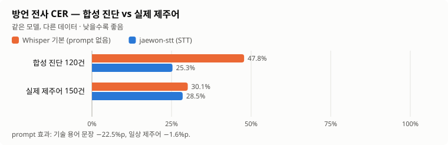
</picture>

- **읽는 법**: 막대가 짧을수록 받아쓰기 오류가 적다.
- 기술 용어가 든 문장(합성 진단)에서는 prompt가 오류를 **절반 가까이**(−22.5%p) 줄였다.
- 기술 용어가 없는 실제 제주어 일상 발화에서는 **−1.6%p**에 그쳤다.
- 결론: prompt는 "용어 사전" 역할만 한다. 사투리 자체를 잘 받아쓰려면 **파인튜닝이 필요하다**.

### 2-2. 기술 용어는 STT에서 대부분 사라지고, LLM이 절반을 되살린다

<picture>
  <source media="(prefers-color-scheme: dark)" srcset="docs/charts/stage-term-funnel-dark.svg">
  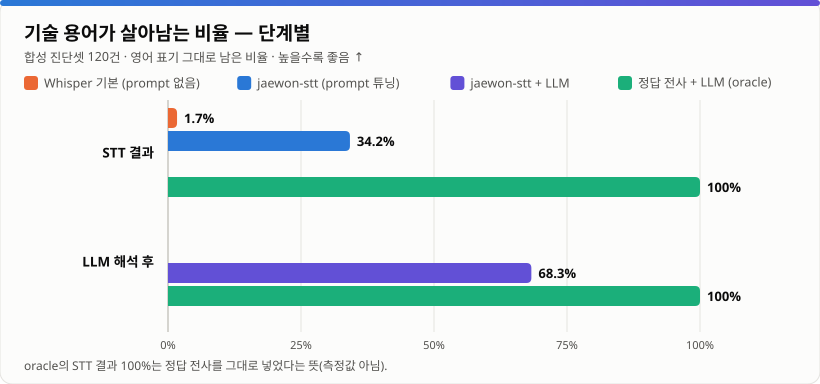
</picture>

- **읽는 법**: 막대가 길수록 `Kubernetes`, `Ingress` 같은 용어가 영어 표기 그대로 살아 있다.
- Whisper 기본은 용어를 거의 전부 한글 발음(`잉그레스`, `디플로이먼트`)으로 쓴다 → **1.7%**.
- prompt를 붙이면 **34.2%**, LLM이 `잉그레스 → Ingress`처럼 복원하면 **68.3%**.
- 정답 전사를 넣으면 LLM은 용어를 100% 지킨다 → 남은 31.7%p는 **STT 단계의 손실**이다.

### 2-3. 권역별 차이

<picture>
  <source media="(prefers-color-scheme: dark)" srcset="docs/charts/syn-cer-by-region-dark.svg">
  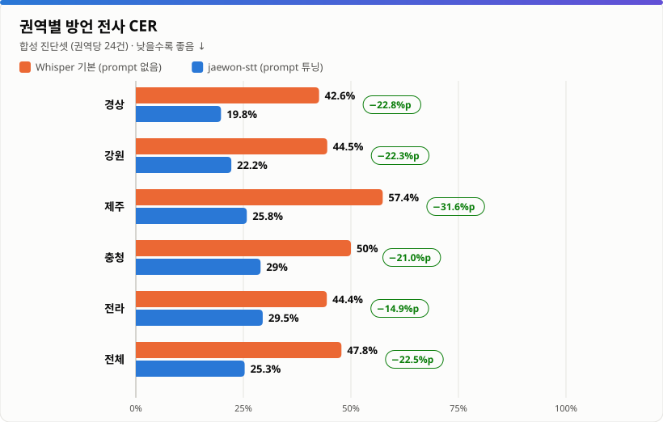
</picture>

<picture>
  <source media="(prefers-color-scheme: dark)" srcset="docs/charts/syn-term-by-region-dark.svg">
  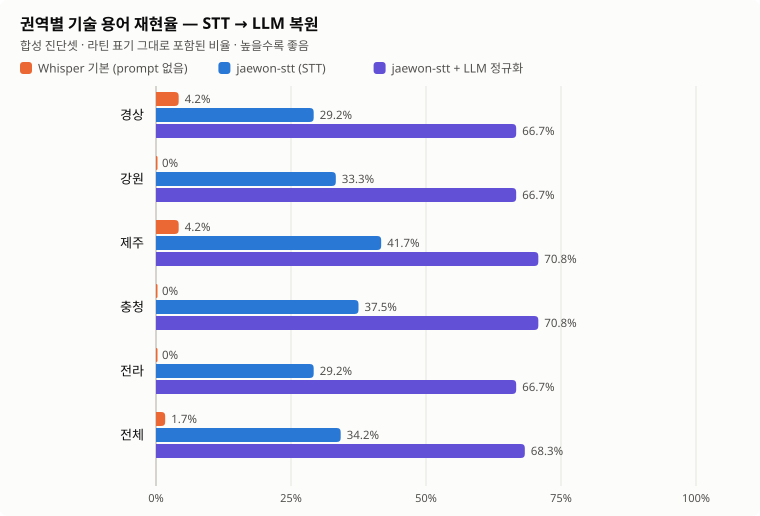
</picture>

| 권역 | CER (기본 → jaewon) | 용어 재현율 (STT → LLM 후) | 표준어 CER |
| --- | --- | --- | --- |
| 경상 | 42.6% → **19.8%** | 29.2% → 66.7% | 33.0% |
| 강원 | 44.5% → 22.2% | 33.3% → 66.7% | **25.1%** |
| 제주 | 57.4% → 25.8% | **41.7% → 70.8%** | 30.7% |
| 충청 | 50.0% → 29.0% | 37.5% → 70.8% | 31.7% |
| 전라 | 44.4% → 29.6% | 29.2% → 66.7% | 48.2% |

- 모든 권역에서 같은 방향으로 개선됐다. 개선 폭은 제주(−31.6%p)가 가장 크고 전라(−14.8%p)가 가장 작다.
- 전라 표준어 CER이 높은 것은 `거시기 … 쓰겄는디` 같은 문장이 의역되기 쉬워서다.
- ⚠️ 이 두 그래프는 **합성 음성 진단값**이다(억양 없음). 실음성 권역 비교는 2차에서 AI Hub 데이터로 측정한다.

### 2-4. 실제 제주어: 고오류 문장은 줄었지만 분포는 여전히 넓다

<picture>
  <source media="(prefers-color-scheme: dark)" srcset="docs/charts/jeju-cer-histogram-dark.svg">
  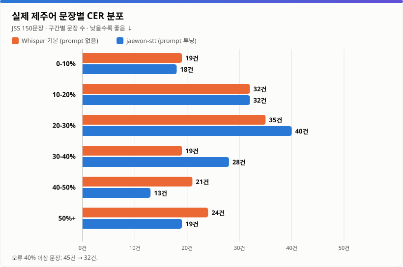
</picture>

- **읽는 법**: 위쪽(오류 낮음) 구간에 문장이 많을수록 좋다. 실제 원어민 음성 150문장이다.
- jaewon-stt는 오류 40% 이상 문장을 **45건 → 32건**으로 줄였지만, 30~40% 구간이 19건 → 28건으로 늘어 **평균은 크게 변하지 않았다**(중앙값 26.5%).
- 대표 오류는 Whisper가 사투리를 표준어로 **고쳐 쓰는** 것이다: `익숙헌 사름이 … 놓면` → `익숙한 사람이 … 놓으면`. 귀로는 맞게 들었지만 방언 전사 기준으로는 오류다.

### 2-5. STT 오류가 최종 품질을 얼마나 깎는가

<picture>
  <source media="(prefers-color-scheme: dark)" srcset="docs/charts/std-cer-stt-cost-dark.svg">
  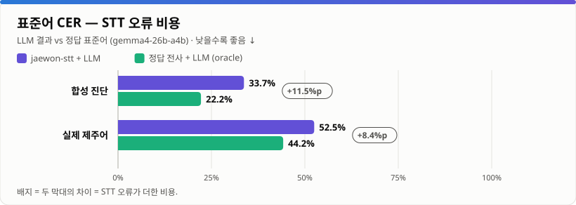
</picture>

- **읽는 법**: 보라(STT 결과를 LLM에 넣음)와 초록(정답을 LLM에 넣음)의 차이 = **STT 오류 때문에 잃는 품질**.
- 합성 진단: **+11.5%p** — 표준어 오류의 약 ⅓이 STT에서 온다 → STT 파인튜닝 효과가 크다.
- 실제 제주어: **+8.4%p**, 그런데 LLM 단독도 44.2% → 제주어는 **LLM 번역 한계가 더 크다**. 정규화 단계도 함께 개선해야 한다(JIT 병렬 데이터 few-shot, 방언 사전).

### 2-6. 2차 이후 목표

<picture>
  <source media="(prefers-color-scheme: dark)" srcset="docs/charts/targets-higher-dark.svg">
  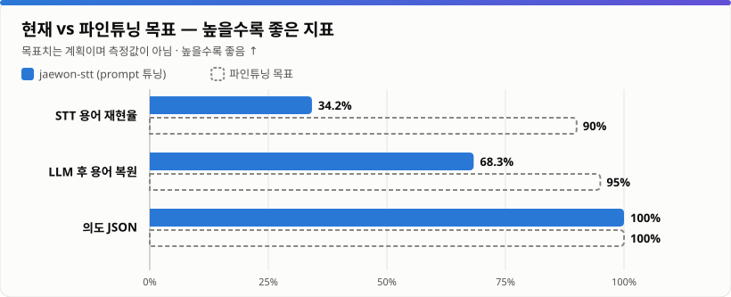
</picture>

<picture>
  <source media="(prefers-color-scheme: dark)" srcset="docs/charts/targets-lower-dark.svg">
  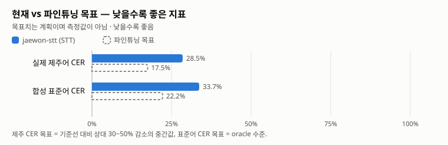
</picture>

- 점선은 **계획치**다. 파인튜닝 후 같은 평가셋으로 실측해 교체한다.
- 가장 큰 격차는 **STT 용어 재현율**(34.2% → 90%)이다. 2차 학습의 1순위 목표다.

---

## 3. 1차 범위: 완료와 미완료

| 영역 | 항목 | 상태 |
| --- | --- | --- |
| 설계 | 2단계 구조(방언 전사 + LLM 정규화), 표기 규칙 | ✅ 완료 |
| 모델 | `jaewon-stt`, `jaewon-tts` 등록 (LiteLLM 고정 이름) | ✅ 완료 — **STT는 학습 전 임시 백엔드** |
| 도구 | 평가(`evaluate_baseline.py`), 증강(`synthesize_augmentation.py`), 제주어 평가셋(`prepare_jss.py`), 그래프(`make_charts.py`) | ✅ 완료 |
| 평가 | 합성 진단 120건 (5개 권역) — prompt 효과, oracle 비교 | ✅ 완료 |
| 평가 | 실제 제주어 150건 — 첫 실음성 기준선 | ✅ 완료 |
| 평가 | 경상·전라·충청·강원 실음성 기준선 | ⏳ 미완료 — AI Hub 데이터 필요 |
| 데이터 | 학습 데이터 구성 (실음성 + 표준어 + 용어 합성 ≤30%) | ⏳ 미완료 |
| **학습** | **Whisper LoRA 파인튜닝** | ⏳ **미완료 — 외부 GPU 필요** |
| 학습 | 정규화 LLM 개선 (방언 few-shot·사전) | ⏳ 미완료 |
| 검증 | 파인튜닝 모델 vs 기준선 비교, 카나리 교체 | ⏳ 미완료 |
| 서비스 | Dialect Gateway API, 스트리밍 | ⏳ 설계만 완료 ([9장](#9-서비스-방법)) |

현재 모델 구성:

| 이름 | 백엔드 | 설정 | 비고 |
| --- | --- | --- | --- |
| `jaewon-stt` | Groq `whisper-large-v3` | `language=ko` + 사투리 어미·기술 용어 prompt | 학습 후 외부 GPU의 파인튜닝 모델로 교체 예정 |
| `jaewon-tts` | Google Cloud TTS `ko-KR-Standard-A` | 한국어 Standard 음성 | 학습용 용어 합성 음성 생성 |
| 정규화 LLM | `gemma4-26b-a4b` (자체 서버) | `request` / `faithful` prompt | 학습 미적용 |

---

## 4. 설계

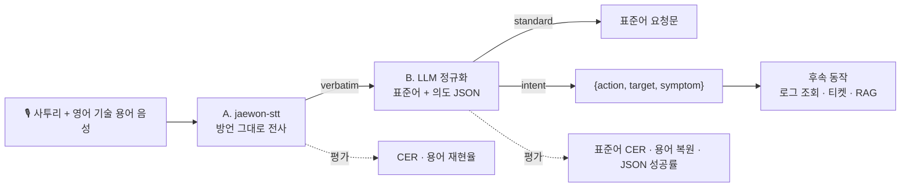

**왜 두 단계인가**

| 비교 | 한 번에 표준어로 받아쓰기 | **두 단계 (이 프로젝트)** |
| --- | --- | --- |
| 정량 평가 | 발화와 정답이 달라 CER 측정 불가 | 단계별 CER 측정 |
| 오류 원인 | 인식 오류와 해석 오류가 섞임 | oracle 비교로 분리 ([2-5](#2-5-stt-오류가-최종-품질을-얼마나-깎는가)) |
| 환각 | 들리지 않은 표준어 생성 위험 | 전사는 들린 그대로, 해석은 문맥으로 |
| 원문 확인 | 원문 소실 | `verbatim`과 `standard` 동시 제공 |
| 모델 교체 | 전체 재학습 | STT·LLM 각각 교체 |

**표기 규칙**: 영어 기술 용어는 라틴 문자(`Kubernetes Pod`)로 통일한다. 정답 표기가 섞이면 모델 출력도 섞인다.

---

## 5. 평가 방법

| 지표 | 정의 | 좋은 방향 |
| --- | --- | --- |
| 방언 CER | 정답 방언 전사 대비 STT 결과의 문자 오류율 (편집 거리 ÷ 정답 길이) | ↓ |
| 용어 재현율 | 정답 기술 용어가 STT 결과에 영어 표기 그대로 들어간 비율 | ↑ |
| 정규화 후 용어 복원 | LLM 결과에 기술 용어가 살아 있는 비율 | ↑ |
| 표준어 CER | 정답 표준어 대비 LLM 결과의 문자 오류율 | ↓ |
| 의도 JSON 성공률 | `intent.action`이 있는 유효 JSON 비율 | ↑ |

- CER은 공백·문장부호·대소문자를 무시한다. 제주어 아래아(ᆞ/ᆢ)는 현대 모음(ㅏ/ㅕ)으로 바꿔 비교한다.
- **oracle 모드**: 정답 전사를 LLM에 바로 넣어 LLM 단독 성능을 잰다. STT를 넣은 결과와의 차이가 STT 오류 비용이다.

| 평가셋 | 합성 진단셋 | 실제 제주어 (JSS) |
| --- | --- | --- |
| 건수 | 120 (5개 권역 × 24) | 150 |
| 화자 | Google TTS Standard A~D (합성) | 제주어 원어민 1명 |
| 사투리 억양 | 없음 (어미·어휘만 사투리) | 있음 |
| 기술 용어 | 문장마다 1개 (12종) | 없음 |
| 표준어 정답 | 문장 틀에 함께 작성 | JIT 병렬 말뭉치 매칭 (149건) |
| 성격 | **진단** (기준선 아님) | **기준선** |

실행 기록:

| # | 구성 | 평가셋 | 결과 파일 |
| --- | --- | --- | --- |
| ① | jaewon-stt + LLM (`request`) | 합성 | `results/2026-10-29-synthetic/report-jaewon-stt.json` |
| ② | Whisper 기본 (`language=ko`) | 합성 | `…/report-whisper-noprompt.json` |
| ③ | oracle + LLM | 합성 | `…/report-oracle-normalize.json` |
| ④⑤⑥ | 위와 동일 (`faithful`) | 실제 제주어 | `results/2026-10-29-jeju/summary.json` (집계만) |

---

## 6. 데이터와 라이선스

| 데이터 | 용도 | 라이선스 | 저장소 포함 |
| --- | --- | --- | --- |
| 사투리 문장 틀 10개 × 기술 용어 12개 (`data/`) | 합성 진단·증강 | 본 프로젝트 | 포함 |
| 합성 진단 manifest·보고서 | 결과 | 본 프로젝트 (음성 제외) | 포함 |
| [Kakao Brain JSS](https://github.com/kakaobrain/jejueo) 제주어 음성 | 실음성 평가 | **CC BY-NC-SA 4.0** | 미포함 — `prepare_jss.py`로 재구성 |
| [Kakao Brain JIT](https://github.com/kakaobrain/jejueo) 제주어-표준어 병렬 | 표준어 정답 | **CC BY-NC-SA 4.0** | 미포함 |
| AI Hub 지역별 방언 발화 (5개 권역) | 2차 학습·평가 | AI Hub 약관 | 미확보 (신청 필요) |

- JSS/JIT는 **비상업 평가 용도로만** 쓰며 상용 모델 학습에 쓰지 않는다. 출처: Park, Choe, Ham, *Jejueo Datasets for Machine Translation and Speech Synthesis*, LREC 2020.
- TTS 합성 음성은 사투리 억양을 재현하지 못하므로 **기술 용어 노출용**으로만 쓰고, 학습 데이터의 30% 이하로 제한하며, **평가셋에는 넣지 않는다**. 학습 사용 전 TTS 제공업체 약관을 확인한다.

---

## 7. 사용 방법

```bash
pip install -r requirements.txt
export LITELLM_BASE_URL=https://<litellm-gateway>/v1
export LITELLM_API_KEY=<virtual key>
```

| 작업 | 명령 |
| --- | --- |
| STT 호출 | `curl $LITELLM_BASE_URL/audio/transcriptions -H "Authorization: Bearer $LITELLM_API_KEY" -F model=jaewon-stt -F file=@sample.wav` |
| 합성 진단셋 생성 | `python synthesize_augmentation.py --limit 120 --execute --out runs/syn` (기본은 dry run) |
| 합성 진단 평가 | `python evaluate_baseline.py runs/syn/manifest.jsonl --diagnostic --stt-model jaewon-stt --llm-model <LLM> --delay 3.5` |
| prompt 없는 비교 | `python evaluate_baseline.py runs/syn/manifest.jsonl --diagnostic --stt-model groq-whisper-large-v3 --language ko --skip-normalize` |
| LLM 단독(oracle) | `python evaluate_baseline.py runs/syn/manifest.jsonl --diagnostic --oracle --llm-model <LLM>` |
| 제주어 평가셋 구성 | `python prepare_jss.py --count 150 --out runs/jeju` (4.4GB 중 필요한 클립만 수신) |
| 제주어 평가 | `python evaluate_baseline.py runs/jeju/manifest.jsonl --stt-model jaewon-stt --llm-model <LLM> --prompt faithful` |
| 그래프 재생성 | `python make_charts.py` |

manifest 형식 (JSONL):

```json
{"audio": "clips/gs-0001.wav", "region": "gyeongsang", "verbatim": "야, Kubernetes Pod가 와 이래 자꾸 죽노? 로그 좀 봐도.",
 "standard": "Kubernetes Pod가 왜 계속 종료되는지 로그를 확인해 주세요.", "terms": ["Kubernetes", "Pod"], "synthetic": false}
```

- 합성 행(`synthetic: true`)이 든 manifest는 `--diagnostic` 없이는 평가를 거부한다.
- Groq 무료 계층은 분당 요청 수 제한이 있다. 다른 서비스와 키를 공유하면 `--delay 3.5` 이상으로 순차 실행한다.

저장소 구조:

```text
korean-dialect-stt/
├── README.md
├── CHANGELOG.md
├── evaluate_baseline.py          # 평가 (STT + 정규화, 권역별 지표)
├── synthesize_augmentation.py    # jaewon-tts 학습용 합성 음성 (기본 dry run)
├── prepare_jss.py                # 공개 제주어 음성 평가셋 구성
├── make_charts.py                # results/ → docs/charts/ 그래프
├── data/                         # 사투리 문장 틀, 기술 용어
├── litellm/register_jaewon_audio.py
├── docs/PIPELINE.md, docs/charts/
└── results/2026-10-29-synthetic/, results/2026-10-29-jeju/
```

---

## 8. 로드맵과 예상 결과

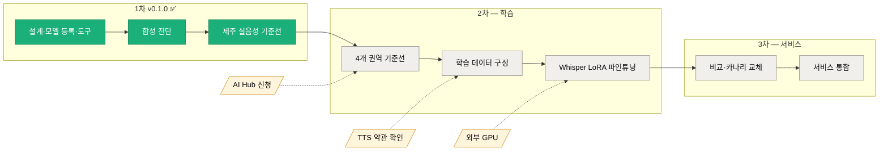

| 단계 | 내용 | 선행 조건 |
| --- | --- | --- |
| 2차 | 4개 권역 실음성 기준선, 학습 데이터 구성, Whisper large-v3(-turbo) LoRA 파인튜닝, 정규화 LLM 개선 | AI Hub 승인, 외부 GPU(A100/L40S급 1장), TTS 약관 |
| 3차 | 같은 평가셋으로 비교 → `jaewon-stt` 백엔드 카나리 교체 → 서비스 통합 | 2차 |

학습 설정 초안: large-v3-turbo + LoRA(r=32), 학습률 1e-4, bf16, SpecAugment, 화자 단위 train/dev/test 분리, 권역 균형 샘플링, epoch마다 권역별 CER·용어 재현율 검증.

**예상 결과** (목표치이며 측정값 아님 — 그래프 [2-6](#2-6-2차-이후-목표))

| 지표 | 1차 (학습 전) | 2차 목표 | 근거 |
| --- | --- | --- | --- |
| 실음성 CER | 제주 28.5% | 기준선 대비 상대 30~50% 감소 | 방언형 정답 실음성 학습 |
| STT 용어 재현율 | 34.2% | 90% 이상 | 용어 집중 학습 + 라틴 표기 정답 |
| 정규화 후 용어 복원 | 68.3% | 95% 이상 | STT 개선 + oracle 상한 100% |
| 표준어 CER (합성) | 33.7% | oracle 수준 ≈22% | STT 오류 비용 11.5%p 제거 |
| 의도 JSON | 100% | 100% 유지 | — |

| 시나리오 | 1차 | 2차 이후 기대 |
| --- | --- | --- |
| 사투리 + 기술 용어 장애 보고 | 용어 ⅓만 정확, LLM이 ⅔까지 복원 | 용어 대부분 정확 → intent로 로그 조회 자동 실행 |
| 제주어 일상 발화 전사 | CER 28.5%, 표준어로 고쳐 씀 | CER 15~20%, 방언형 유지 |
| 제주어 → 표준어 번역 | 표준어 CER 52.5% | LLM 개선 병행 시 40% 이하 |

위험 요인: AI Hub 데이터와 IT 대화의 도메인 차이, 고령 화자 위주 분포, 단일 화자 JSS의 일반화 한계, 합성 음성 과적합.

---

## 9. 서비스 방법

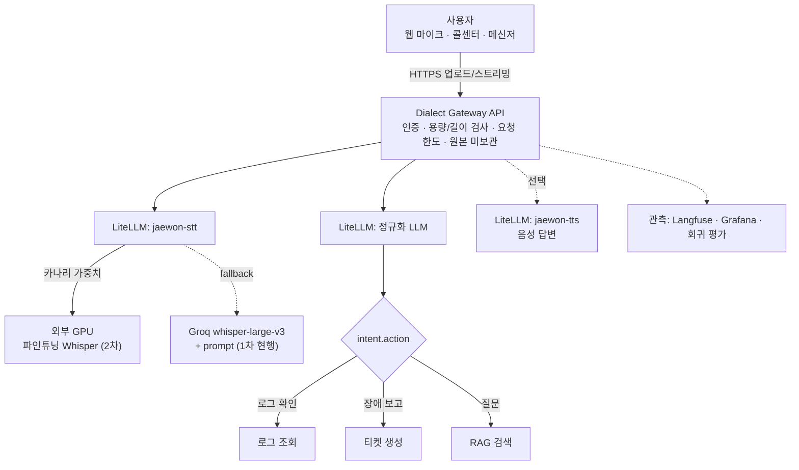

**API (제안)**

```http
POST /v1/dialect/understand      multipart: file=<audio>, style=request|faithful

200 OK
{"verbatim": "야, Kubernetes Pod가 와 이래 자꾸 죽노? 로그 좀 봐도.",
 "standard": "Kubernetes Pod가 왜 계속 종료되는지 로그를 확인해 주세요.",
 "intent": {"action": "로그 확인", "target": "Kubernetes Pod", "symptom": "잦은 종료"},
 "models": {"stt": "jaewon-stt", "llm": "..."}, "latency_ms": {"stt": 820, "normalize": 640}}
```

`verbatim`과 `standard`를 함께 돌려줘 사용자가 원문을 확인·수정할 수 있게 한다. OpenAI 호환 클라이언트는 `jaewon-stt`를 직접 호출해 전사만 쓸 수도 있다.

**서빙 방식 비교**

| 방식 | 지연 | 비용 | 품질 | 운영 부담 | 시기 |
| --- | --- | --- | --- | --- | --- |
| Groq Whisper + prompt | 낮음 | 무료 계층 / 사용량 과금 | 1차 기준선 | 낮음 | **현재** |
| 외부 GPU + 파인튜닝 Whisper | 중간 | GPU 시간 과금 | 2차 목표 | 중간 | 2차 이후 |
| 하이브리드 (카나리 + fallback) | 낮음~중간 | 혼합 | 목표 + 가용성 | 중간 | 전환 기간 |
| 온디바이스 (증류 모델) | 매우 낮음 | 단말 | 낮음 | 높음 | 장기 검토 |

**운영 원칙**

| 영역 | 원칙 |
| --- | --- |
| 모델 배치 | 추론은 클러스터 밖 GPU, 게이트웨이에는 엔드포인트만 등록. faster-whisper(CTranslate2) 등 OpenAI 호환 서버 |
| 배포 | 같은 이름(`jaewon-stt`)에 두 백엔드를 가중치로 등록해 10% → 50% → 100%, Groq 경로를 fallback으로 유지 |
| 품질 | 모델·prompt 변경마다 고정 실음성 평가셋으로 회귀 평가, 기준보다 나빠지면 배포 중단 |
| 개인정보 | 녹음 원본 미보관, 로그·트레이스에는 텍스트만(필요 시 마스킹), 외부 제공업체 보관 정책 확인 |
| 요청 한도 | 사용자·IP별 분당 요청과 동시 처리 제한으로 제공업체 429가 다른 서비스에 번지지 않게 함 |
| 비용·약관 | 무료/체험 계층은 상용 보장 없음. 비상업 데이터(JSS/JIT)는 상용 학습 금지 |
| 실시간 | VAD로 0.5~1초 청크 부분 전사 → 발화 종료 시 전체 재전사 후 정규화 |

**적용 시나리오**: 음성 장애 접수(intent로 로그 자동 조회), 고객 상담 녹취 요약·티켓 작성, 음성 질문 기반 사내 문서 검색, 웹 음성 비서(원문/표준어 확인 후 전송).

---

## 10. 한계

- **학습 미완료**: 1차 수치는 모두 파인튜닝 전 기준선이다.
- 합성 진단셋은 억양이 없고 화자가 적어 실제 성능을 과대/과소평가할 수 있다. 실음성 기준선은 제주어 **단일 화자 150문장**뿐이다.
- 용어 재현율은 부분 문자열 일치라 `ArgoCD`(붙여 씀)와 `Argo CD`를 다르게 집계한다.
- 표준어 CER은 의역에 민감하다. 2차에서 의미 일치 평가(LLM judge, 사람 평가)를 보완한다.
- 제주어 아래아 변환(ᆞ→ㅏ, ᆢ→ㅕ)은 근사치다.

---

*v0.1.0 · 2026-10-29 · 1차분(기준선·평가 체계) — 파인튜닝 미완료. 변경 이력은 [CHANGELOG.md](CHANGELOG.md).*
